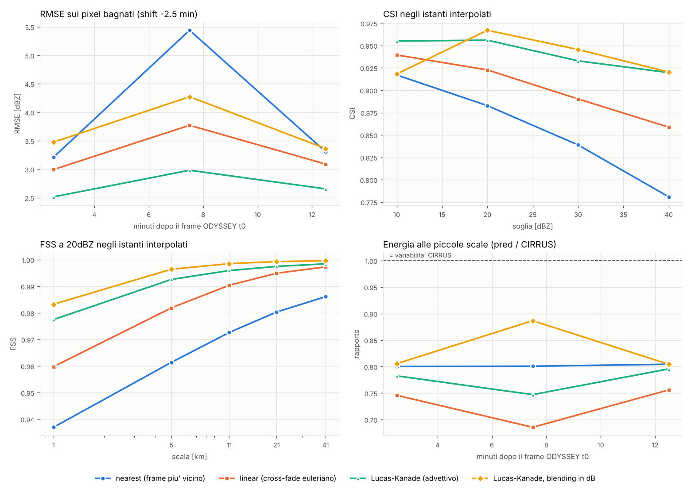

# DECADE – a harmonised decade of OPERA radar data

**DE**ep-learning nowCasting from **A** harmonised **DE**cade of radar data.

Deep-learning nowcasting models such as IRENE (FBK, Camilletti et al., 2026) are
trained on multi-year radar archives at 1 km / 5 min. At European scale, the
EUMETNET OPERA composites exist at that resolution only since July 2024
(CIRRUS). The 2012–2024 legacy archive (ODYSSEY) covers a decade, but at 2 km /
15 min. DECADE builds a harmonised OPERA archive at 1 km / 5 min from 2012
onwards and measures, over a Belgian pilot domain, whether pre-training IRENE on
it improves nowcasts compared with training on the current products alone.

This repository holds the data side of the project: reading OPERA composites,
temporal super-resolution of ODYSSEY by optical flow, validation against CIRRUS,
and the extraction of training windows in IRENE format. Only pan-European
sources are used in the method (OPERA, ECA&D, EURADCLIM), so that it scales from
Belgium to the whole OPERA domain.

| research question | status in this repo |
|---|---|
| 1. Bring ODYSSEY to 1 km / 5 min, consistent with CIRRUS | LK optical-flow interpolation with mass conservation (CPU, OpenCV), validated on 1–5/7/2024. To do: GPU (PyTorch) version, quantile-mapping correction, year-by-year consistency checks, validation against VMM |
| 2. Value of legacy data for training IRENE (configurations A, B, C) | window sampler and Zarr store in IRENE format. Training happens on Leonardo Booster with the IRENE code |
| 3. Hydrological value against STEPS and the Flood4Cast LK nowcast | not started |

The plan and the current state (in Italian) are in
[`docs/handoff.md`](docs/handoff.md). Verified facts about the OPERA products
(grids, encodings, time windows, gaps in the archive) are in
[`CLAUDE.md`](CLAUDE.md), also in Italian.

## Getting started

You need [`uv`](https://docs.astral.sh/uv/). It installs the right Python (3.12)
and every dependency, including JupyterLab.

```bash
git clone https://github.com/fedro86/DECADE.git
cd DECADE
uv sync                      # creates .venv with opera_ds installed in editable mode
uv run pre-commit install    # strips notebook outputs at every commit
uv run jupyter lab           # then open notebooks/01-quickstart.ipynb
```

In VS Code, select the interpreter `.venv/bin/python` as the notebook kernel.
Always run Python through `uv run` (for example `uv run python scripts/...`), so
that it uses the project environment.

The quickstart notebook downloads about 10 MB from the public archive and runs in
under a minute: it reads ODYSSEY and CIRRUS over Belgium, interpolates one
ODYSSEY pair to 5 min and compares it with CIRRUS.

## Repository layout

```
opera_ds/        the library: everything that must run in production lives here
scripts/         command-line entry points (download, validation, production, ML windows)
notebooks/       exploration and figures, built on opera_ds (outputs are not committed)
tests/           synthetic end-to-end test, run by CI on every push
configs/         parameter files for the CLI (--config)
docs/            plan (handoff.md) and reference figures
data/            downloaded data, not in git        (or $OPERA_DATA_DIR)
results/         validation and experiment outputs, not in git  (or $OPERA_RESULTS_DIR)
```

**Notebooks explore, scripts produce.** The archive will be produced and the
models trained on HPC (Leonardo Booster), as batch jobs without notebooks. A
method tried in a notebook becomes part of the pipeline only once it is moved
into `opera_ds/`, exposed through a script in `scripts/` and covered by a test.
See [`CONTRIBUTING.md`](CONTRIBUTING.md).

## Data

All OPERA data come from the public ORD bucket
`https://s3.waw3-1.cloudferro.com/openradar-archive/` (CC BY 4.0, no
credentials):

| product | file | grid | step | period |
|---|---|---|---|---|
| ODYSSEY max reflectivity | `DBZH_QIND.h5` | 1900 × 2200, 2 km | 15 min | 4/9/2012 → 5/7/2024 |
| ODYSSEY rain rate | `QIND_RATE.h5` | 1900 × 2200, 2 km | 15 min | same |
| CIRRUS max reflectivity | `DBZH.h5` | 3800 × 4400, 1 km | 5 min | from 1/7/2024 |
| NIMBUS rain rate | `RATE.h5` | 1900 × 2200, 2 km | 15 min | from 5/7/2024 |

All products share the same LAEA projection and corners. In Python,
`opera_ds.ord.download(time, product, out_dir)` fetches a single file; the
scripts below fetch whole periods. Data and results are never committed: they
live in `data/` and `results/` (ignored by git) or in the folders set by
`OPERA_DATA_DIR` and `OPERA_RESULTS_DIR`. Credentials for the optional sources go
in `.env` (template in `.env.example`).

## Downscaling method (ODYSSEY → 1 km / 5 min)

**Grids.** CIRRUS uses the same domain and LAEA projection as ODYSSEY at twice
the resolution (3800 × 4400 against 1900 × 2200): each 2 km pixel covers 2 × 2
pixels at 1 km. The fine pixel `j` lies at coordinate `(j+0.5)/2 − 0.5` of the
coarse grid (aligned centres). Validation checks the alignment from the `where`
metadata and writes it to `grid_check.txt`.

**Motion (Lucas-Kanade, at 2 km).** Same scheme as
`pysteps.motion.lucaskanade`: Shi-Tomasi features → pyramidal LK →
forward-backward check → local outlier removal → declustering → IDW
interpolation and smoothing. The vectors of each pair are reused for the
adjacent pairs (context of ±1 pair). Two differences from the pysteps defaults,
both found in testing:

- LK runs on a **high-pass** field (σ = 15 px), so that growth and decay of cells
  are not mistaken for motion. On the synthetic case the mean motion error drops
  from 5.1 to 2.0 px / 15 min.
- 5000 features instead of 1000, meant for the whole European domain.

The `pysteps` backend remains available (`"lk": {"backend": "pysteps"}`).

**Temporal interpolation.** For a fraction `a` of the interval:

```
F(x, t0 + a·15') = (1−a) · F0(x − a·V) + a · F1(x + (1−a)·V)
```

Trajectories are integrated with the midpoint method in the stationary field at
2 km. Values are sampled **once** from the 2 km field at the departure points of
the 1 km pixels, so upscaling and advection are a single bilinear interpolation.
At `a = 0` the method reduces to plain upscaling.

**Mass conservation (default).** Two choices, evaluated in R with
Marshall-Palmer (Z = 200 R^1.6):

- **Conservative upscaling** (`mass_correction=True`). Interpolating in dBZ
  loses rain, because R is convex in dBZ. For each 2 km pixel a correction in dB
  makes the mean R of its 4 sub-pixels equal to the R of the ODYSSEY pixel; the
  correction follows the values along the trajectories.
- **Blending in R** (`blend_space="R"`). The average of the advected F0 and F1 is
  taken in R. A dry pixel weighs 0, so cell edges do not drop below threshold as
  they do when averaging in dB. Averaging in Z instead adds rain where the
  advected F0 and F1 do not coincide, because R is concave in Z.

On the 4 real days (Belgium, 380 pairs), volume of the output relative to
(1−a)·V(F0) + a·V(F1):

| | α = 0 | α = 1/3 |
|---|---|---|
| bilinear, blending in Z (previous default) | 0.918 | 0.959 |
| correction + blending in Z | 0.999 | 1.065 |
| **correction + blending in R (default)** | **0.999** | **1.011** |

Against CIRRUS the correction doubles the small-scale energy (from 0.17 to 0.33)
and lowers the RMSE of hourly accumulations at 25 km (from 1.12 to 1.07 mm),
with a slightly higher RMSE in dBZ (12.90 against 12.79 mid-interval). On the
synthetic case blending in R has a higher dBZ RMSE than blending in Z
mid-interval (3.7 against 2.9) but a better CSI. The variants remain available as
methods `lk:Z` and `lk:dB`, or with `mass_correction=false` in the configuration.

**Radar coverage.** Coverage is not advected. Where an echo enters from outside
coverage, the only valid source is used, or, if neither is valid, the Eulerian
interpolation.

## Validation

The comparison is with CIRRUS, on the only days when both products are in the
public archive (1–5/7/2024), for three methods:

| method | what it does |
|---|---|
| `nearest` | nearest ODYSSEY frame, upscaled (persistence) |
| `linear` | Eulerian average of F0 and F1 |
| `lk` | advection-based interpolation (variants `lk:Z`, `lk:dB`) |

Metrics are stratified by `alpha`, the position within the 15 min interval.
**The error at `alpha = 0` is the floor**: there is no temporal interpolation
there, so it measures upscaling and the differences between products. What
matters for temporal interpolation is the *extra* error at the other times.

Output files:

- `summary.csv`: bias, MAE, RMSE and correlation in dBZ on wet pixels;
  POD/FAR/CSI/frequency bias at 10/20/30/40 dBZ; FSS at 20/30 dBZ; small-scale
  energy ratio; volume ratio and R errors (mm/h) at 1, 2, 5, 10 and 25 km (`r*`
  columns);
- `mass_internal.csv`: conservation relative to ODYSSEY itself, without the
  differences between products (output volume against (1−a)·V(F0) + a·V(F1), and
  2 × 2 block means at `a = 0`);
- `accum_1h.csv`: hourly accumulations against CIRRUS on the available times, by
  scale;
- `per_time.csv`, `qq.json`, `grid_check.txt` and the plots.

R is obtained with Marshall-Palmer (Z = 200 R^1.6), capping dBZ at 55.

**Time shift.** ODYSSEY uses the window [NT−10, NT+5], CIRRUS (NT−10, NT]: for
the same label, ODYSSEY "sees" about 2.5 min later. `--shifts` tries several
shifts and `time_shift.png` shows which one minimises the error.



## Command-line usage

```bash
# data from the public ORD bucket
uv run python scripts/fetch_ord_archive.py --product DBZH_QIND \
  --start 2024-07-01 --end 2024-07-06 --out data/odyssey
uv run python scripts/fetch_ord_archive.py --product DBZH \
  --start 2024-07-01 --end 2024-07-06 --out data/cirrus

# only Belgium + 350 km, reading the GeoTIFFs in pieces (about 3 h for 12 years of ODYSSEY)
uv run python scripts/fetch_cog_crop.py --product DBZH_QIND \
  --ref "data/odyssey/OPERA@20240702T1200@0@DBZH_QIND.h5" \
  --bbox 2.5 49.45 6.45 51.55 --buffer-km 350 \
  --start 2012-09-01 --end 2024-07-06 --out data/odyssey_bel --threads 32

# Belgium mask on the CIRRUS 1 km grid
uv run python scripts/make_region_mask.py --ref "data/cirrus/OPERA@20240702T1205@0@DBZH.h5" \
  --country BEL --out data/mask_BEL_1km.npy

# validation, cropping on read (Belgium + 200 km)
uv run python scripts/opera_ds_cli.py validate \
  --odyssey-glob "data/odyssey/*@DBZH_QIND.h5" --cirrus-glob "data/cirrus/*@DBZH.h5" \
  --time-regex "@(\d{8}T\d{4})@" --time-format "%Y%m%dT%H%M" \
  --start 2024-07-01 --end 2024-07-06 \
  --bbox 2.5 49.45 6.45 51.55 --buffer-km 200 --region-mask data/mask_BEL_1km.npy \
  --shifts 0 -2.5 -5 2.5 --methods nearest linear lk lk:dB \
  --pair-stride 1 --workers 12 --out results/val_2024-07_BEL

# production
uv run python scripts/opera_ds_cli.py downscale \
  --odyssey-glob "data/odyssey/*@DBZH_QIND.h5" \
  --time-regex "@(\d{8}T\d{4})@" --time-format "%Y%m%dT%H%M" \
  --start 2024-07-01 --end 2024-07-02 \
  --bbox 2.5 49.45 6.45 51.55 --buffer-km 200 --workers 8 --out results/ds

# choice of training windows on ODYSSEY at 2 km: gap filter and importance sampling
uv run python scripts/opera_ds_cli.py sample \
  --odyssey-glob "data/odyssey/*@DBZH_QIND.h5" \
  --time-regex "@(\d{8}T\d{4})@" --time-format "%Y%m%dT%H%M" \
  --start 2024-07-01 --end 2024-07-06 --workers 10 --out results/windows.csv

# ML windows: Zarr store in IRENE format from a CSV with t_start,row0,col0
uv run python scripts/opera_ds_cli.py windows \
  --odyssey-glob "data/odyssey/*@DBZH_QIND.h5" \
  --time-regex "@(\d{8}T\d{4})@" --time-format "%Y%m%dT%H%M" \
  --windows-csv results/windows.csv --T 24 --H 256 --W 256 --context-km 150 \
  --workers 8 --out results/windows.zarr
```

- `sample` follows IRENE's `importance_sampler`, but works directly on the
  ODYSSEY files at 2 km. A window of T frames at 5 min needs
  ⌊(T−1)·5/15⌋ + 2 consecutive ODYSSEY frames (9 for T = 24): if one is missing
  the window is discarded. It is also discarded if the fraction outside coverage
  exceeds `--max-nan-frac` (default 0.64%, as IRENE), and accepted with
  probability q = min(1, q_min + m · mean(1 − e^(−R/s))). The CSV has `t_start`,
  `row0`, `col0` (1 km grid), `q`, `rain_score`, `nan_frac`; a JSON next to it
  holds parameters and statistics. `--bbox`/`--buffer-km` restrict the area.
- Every produced frame carries `alpha` (0 = real ODYSSEY frame, 1/3 and 2/3 =
  interpolated). In the ODIM files it is in `dataset1/how`, together with
  `interpolated`, `time_shift_min`, `source_t0` and `method`.
- Default labels are the ODYSSEY times. `--time-shift -2.5` moves them to the
  CIRRUS convention, but then all frames are interpolated (α = 1/6, 1/2, 5/6).
  For pre-training, leave it at 0.
- The window store has `RR` (n, T, H, W) in mm/h float16 (NaN outside coverage,
  dBZ clipped to [0, 60] as in IRENE), `alpha` and `time` (n, T), `row0` and
  `col0` (n,) on the OPERA 1 km grid; the attributes describe grid, Z-R and
  configuration. Windows with missing ODYSSEY frames are discarded. Motion is
  estimated on a crop with `--context-km` on each side.
- `--time-regex` must capture the timestamp in the file name; without it the
  time is read from the ODIM attributes, more slowly.
- `--bbox` and `--buffer-km` crop on read a window aligned to 2 km, identical
  for the two grids. If `--region-mask` is on the full grid, it is cropped the
  same way.
- `--config configs/config_example.json` changes the parameters of
  `DownscaleConfig` and LK.
- Hourly accumulations in the validation need `--pair-stride 1`.

Production output: ODIM HDF5 2.4, DBZH uint16 (gain 0.01, offset −50), gzip.

## Tests

```bash
uv run pytest                                   # about 3 min
uv run python tests/test_synthetic.py out_test  # same test, keeps the outputs
```

The test generates a multiscale field with known motion (translation and
rotation, about 60 km/h) and growth/decay. It degrades it to "ODYSSEY" (2 km,
15 min, shifted by +2.5 min) and uses it as "CIRRUS" at 1 km / 5 min. It checks
that:

- the estimated shift is −2.5 min;
- LK beats `nearest` and `linear` in RMSE at every interpolated time;
- LK beats `linear` in CSI at 30 dBZ;
- with the defaults the rain volume stays within 2% of that of "ODYSSEY" at every
  `alpha`, and the 2 × 2 block error at `alpha = 0` is below 1%;
- the window sampler and the IRENE-format store behave as expected.

## Results on real data (1–5/7/2024, Belgium)

- ODYSSEY has about **half the rain volume** of CIRRUS (a gap of 3.5–5 dB at all
  quantiles, POD at 10 dBZ about 0.69). It is a difference between products,
  already present at the floor.
- Bilinear upscaling in dBZ lost about **8% of the volume** relative to ODYSSEY;
  with the current defaults the loss is below 1% (see above).
- In hourly accumulations the methods are almost equivalent; for instantaneous
  fields mid-interval LK beats `nearest` (RMSE 12.9 against 13.8 dBZ with the
  defaults).
- The interpolated field has about a third of the small-scale energy of CIRRUS.
- ODYSSEY DBZH contains outliers up to 128 dBZ (clutter): every conversion to R
  must be capped; the validation uses 55 dBZ.

## Limitations

- **Detail below 2 km is not created.** Recovering that variability would need a
  stochastic (e.g. RainFARM) or learned downscaling.
- **The dynamics within the 15 min are synthetic**: two frames out of three are
  combinations of real ones. For ML they must be flagged, and the loss computed
  on real frames.
- **The ODYSSEY/CIRRUS overlap is only 4 summer days** in the public archive,
  without CIRRUS at the quarter hours; for rain it is zero.
- **Motion is stationary within the interval.** With very fast systems (above
  about 120 km/h) LK can lock onto a wrong match.
- **The time shift is not yet applied in production.**
