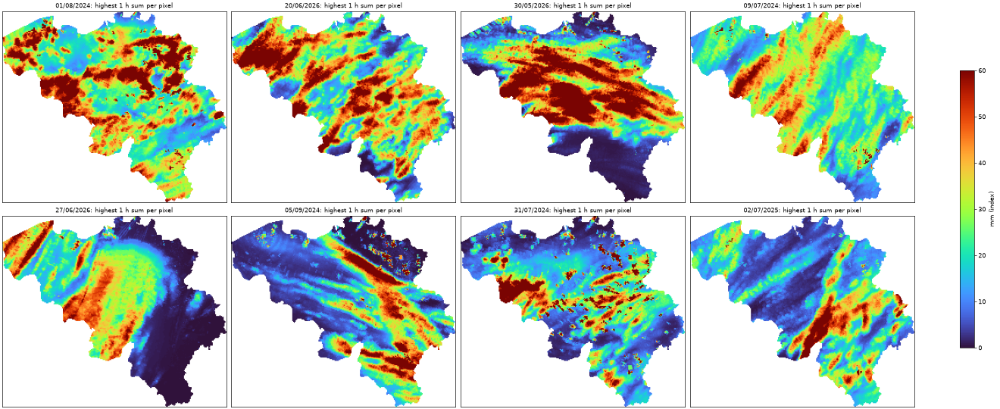

# Method

How the processing works and why it is designed this way, with the evidence
behind each choice. Facts about the input data are in [data.md](data.md);
commands and output files are in [usage.md](usage.md); what is planned but not
built yet is in [roadmap.md](roadmap.md).

## Conventions

- Reflectivity in dBZ, rain rate R in mm/h.
- Z–R: Marshall-Palmer, Z = 200 R^1.6, the same as NIMBUS and IRENE.
- Every conversion to R caps dBZ at 55, because of the outliers in ODYSSEY
  (see [data.md](data.md), *Known problems*).

## Temporal super-resolution of ODYSSEY (2 km / 15 min → 1 km / 5 min)

### Grids

The fine pixel `j` lies at coordinate `(j+0.5)/2 − 0.5` of the coarse grid
(aligned centres). Crops are expressed in metres from the upper-left corner and
aligned to 2000 m, so the 2 km and 1 km grids stay 2:1. Validation checks the
alignment from the `where` metadata and writes it to `grid_check.txt`.

### Motion (Lucas-Kanade, at 2 km)

Same scheme as `pysteps.motion.lucaskanade`: Shi-Tomasi features → pyramidal LK
→ forward-backward check → local outlier removal → declustering → IDW
interpolation and smoothing. The sparse vectors of each pair are reused for the
adjacent pairs (context of ±1 pair). Two differences from the pysteps defaults,
both found in testing:

- LK runs on a **high-pass** field (σ = 15 px), so that growth and decay of
  cells are not mistaken for motion. On the synthetic case the mean motion error
  drops from 5.1 to 2.0 px / 15 min.
- 5000 features instead of 1000, meant for the whole European domain.

The `pysteps` backend remains available (`"lk": {"backend": "pysteps"}`).

### Interpolation

For a fraction `a` (`alpha`) of the 15 min interval:

```
F(x, t0 + a·15') = (1−a) · F0(x − a·V) + a · F1(x + (1−a)·V)
```

Trajectories are integrated with the midpoint method in the stationary field V
at 2 km. Values are sampled **once** from the 2 km field at the departure
points of the 1 km pixels, so upscaling and advection are a single bilinear
interpolation. At `a = 0` the method reduces to plain upscaling.

Radar coverage is not advected. Where an echo enters from outside coverage, the
only valid source is used, or, if neither is valid, the Eulerian interpolation.

### Mass conservation (default)

- **Conservative upscaling** (`mass_correction=True`). Interpolating in dBZ
  loses rain, because R is convex in dBZ (Jensen's inequality). For each 2 km
  pixel a correction in dB makes the mean R of its 4 sub-pixels equal to the R
  of the ODYSSEY pixel; the correction follows the values along the
  trajectories.
- **Blending in R** (`blend_space="R"`). The average of the advected F0 and F1
  is taken in R. A dry pixel weighs 0, so cell edges do not drop below threshold
  as they do when averaging in dB. Averaging in Z instead adds rain where the
  advected F0 and F1 do not coincide, because R is concave in Z.

Evidence on the 4 real days (Belgium, 380 pairs): volume of the output relative
to (1−a)·V(F0) + a·V(F1).

| | α = 0 | α = 1/3 |
|---|---|---|
| bilinear, blending in Z (previous default) | 0.918 | 0.959 |
| correction + blending in Z | 0.999 | 1.065 |
| **correction + blending in R (default)** | **0.999** | **1.011** |

Against CIRRUS the correction doubles the small-scale energy (from 0.17 to
0.33 of CIRRUS) and lowers the RMSE of hourly accumulations at 25 km (from 1.12
to 1.07 mm), with a slightly higher RMSE in dBZ (12.90 against 12.79
mid-interval). On the synthetic case blending in R has a higher dBZ RMSE than
blending in Z mid-interval (3.7 against 2.9) but a better CSI. The variants
remain available as methods `lk:Z` and `lk:dB`, or with `mass_correction=false`.

### Output labels and `alpha`

Every produced frame carries `alpha`: 0 is a real ODYSSEY frame, 1/3 and 2/3
are interpolated. By default the output labels are the ODYSSEY times. A time
shift of −2.5 min moves them to the CIRRUS convention (see [data.md](data.md),
*Time windows*), but then every frame is interpolated (α = 1/6, 1/2, 5/6). Which
convention is used for training is a decision recorded in
[roadmap.md](roadmap.md).

## Validation against CIRRUS

Compared methods:

| method | what it does |
|---|---|
| `nearest` | nearest ODYSSEY frame, upscaled (persistence) |
| `linear` | Eulerian average of F0 and F1 |
| `lk` | advection-based interpolation above (variants `lk:Z`, `lk:dB`) |

Metrics are stratified by `alpha`. **The error at `alpha = 0` is the floor**:
there is no temporal interpolation there, so it measures upscaling and the
differences between products. What matters for temporal interpolation is the
*extra* error at the other times. Scores: bias, MAE, RMSE and correlation in
dBZ on wet pixels; POD/FAR/CSI/frequency bias at 10/20/30/40 dBZ; FSS at
20/30 dBZ; small-scale energy ratio; volumes and R errors at 1–25 km; hourly
accumulations; internal conservation against ODYSSEY itself. Several time
shifts are tried to find the one that minimises the error.

### Results on 1–5/7/2024, Belgium (current defaults)

- With the current defaults the volume stays within 1% of ODYSSEY at every
  `alpha` (bilinear upscaling in dBZ lost about 8%).
- Hourly accumulations: the methods are almost equivalent.
- Instantaneous fields mid-interval: LK beats `nearest` (RMSE 12.9 against
  13.8 dBZ).
- The interpolated field has about a third of the small-scale energy of CIRRUS.
- The ODYSSEY/CIRRUS level difference (see [data.md](data.md)) dominates the
  floor error; it is a product difference, not an interpolation error.


### Degraded CIRRUS as a stand-in for ODYSSEY

To measure the interpolation error over months with a known truth (H1),
CIRRUS is degraded to the ODYSSEY grid (`opera_ds.validate.degrade_frame`) and
kept every 15 min; the degraded frames are interpolated back to 5 min and scored
against the real CIRRUS (`notebooks/02-mr-degraded-cirrus.ipynb`). The
degradation should look like real ODYSSEY, otherwise it measures the error on an
input that is easier or harder to interpolate.

Three degradations of each 2 × 2 block were compared with real ODYSSEY on
1–5/7/2024: mean in linear Z (`zmean`), maximum (`max`) and the upper-left pixel
(`sample`). ODYSSEY at NT is paired with CIRRUS at NT+5, the closest window
([data.md](data.md), *Time windows*); 382 pairs, values capped at 55 dBZ against
the ODYSSEY outliers ([data.md](data.md), *Known problems*). Distributions of wet pixels (≥ 10 dBZ) are compared by
shape, after removing the median offset, since the products differ in level;
small-scale energy is the high-pass energy (Gaussian, σ = 2 px) relative to
ODYSSEY.

| area | variant | median offset to ODYSSEY [dB] | QQ shape RMS [dB] | small-scale energy / ODYSSEY |
|---|---|---:|---:|---:|
| Belgium + 200 km | `zmean` | −0.04 | 0.39 | 1.39 |
| | `max` | 0.70 | 0.78 | 1.63 |
| | `sample` | −0.20 | 0.43 | 1.53 |
| Belgium | `zmean` | 1.30 | 0.67 | 2.13 |
| | `max` | 2.61 | 1.21 | 2.50 |
| | `sample` | 0.86 | 0.63 | 2.25 |

- `zmean` is the closest to ODYSSEY: lowest small-scale energy everywhere, best
  or tied distribution shape. It is the degradation used in H1.
- No degradation is smoother than ODYSSEY: real ODYSSEY has 1.4–2.1 times less
  small-scale energy than CIRRUS degraded by `zmean`. Degraded CIRRUS is
  therefore a rougher, not an easier, input than ODYSSEY.
- The OPERA product sheet describes the composite value as the maximum of all
  contributing single-scan pixels
  ([summary](sources/2024%20-%20EUMETNET%20-%20OPERA%20CIRRUS%20maximum%20reflectivity%20composite%20user%20product%20sheet.md)),
  which is closer to the `max` degradation; yet `zmean` matches real ODYSSEY
  better. This is measured, not explained.

### Convective and stratiform pixels

Scores can be split by precipitation type on each pixel of the truth, so no
label per time is needed (`opera_ds/classify.py`, option `classifier` of
`run_validation`). The rule is Steiner et al. (1995)
([summary](sources/1995%20-%20Steiner%20-%20Climatological%20characterization%20of%20three-dimensional%20storm%20structure%20from%20operational%20radar%20and%20rain%20gauge%20data.md)),
with its published parameters:

| parameter | value | source |
|---|---|---|
| convective centre by intensity | ≥ 40 dBZ | Steiner 1995, section 6c; also the RMI storm threshold in Belgium, Goudenhoofdt and Delobbe 2013 ([summary](sources/2013%20-%20Goudenhoofdt%20-%20Statistical%20characteristics%20of%20convective%20storms%20in%20Belgium%20derived%20from%20volumetric%20weather%20radar%20observations.md)) |
| background | mean in linear Z of the echo pixels within 11 km | Steiner 1995, section 6c |
| convective centre by peakedness | above the background by ΔZ = 10 dB below 0 dBZ, 10 − Z_bg²/180 up to 42.43 dBZ, 0 above | Steiner 1995, Eq. 2 |
| convective radius around a centre | 1 km below 25 dBZ of background, then 2, 3, 4 km every 5 dBZ, 5 km from 40 dBZ | Steiner 1995, Fig. 6b, "medium" |
| grid | 2 km: the 1 km truth is degraded by `zmean`, classified, and each 2 km class copied to its 2 × 2 block | the parameters were tuned on 2 km, and a finer grid gives too much convective area (Steiner 1995, section 6d) |

Echo pixels are those above the floor of the validation fields; everything with
echo that is not convective is stratiform. 2 km is also the ODYSSEY grid, so the
same classification can run on the archive.

Convective share of the echo area over Belgium on the H1 test week
(8–14/9/2025, 2,016 wet CIRRUS times), against Steiner 1995, Table 3 (Darwin,
February 1988, 2 km):

| grid | convective area | this week | Steiner 1995 |
|---|---|---:|---:|
| 1 km | medium radius | 25.4% | — |
| 2 km | medium radius | 21.3% | 12% (case 2d) |
| 2 km | centres only | 9.0% | 3% (case 2b) |

- The 1 km grid gives a larger convective share than 2 km, as section 6d
  reports; this is the reason for the 2 km grid.
- The radius takes the convective share from 9.0% to 21.3% (×2.4), while in
  the paper it goes from 3% to 12% (×4). The excess over Steiner is in the
  centres (×3), not in the radius. A Darwin month and a Belgian September week
  are not directly comparable.

Known limits: the method was tuned on a tropical radar at a fixed 3 km height.
OPERA `DBZH` is a maximum-reflectivity composite, so a bright band above
40 dBZ can be labelled convective, mostly in the cold season. Check over
Belgium, Steiner at 2 km, all CIRRUS frames of each period, convective centres
counted on the 2 km grid (`steiner_centres`):

| period | convective share of the echo area | centres by intensity (≥ 40 dBZ) | centres by peakedness only |
|---|---:|---:|---:|
| 8–14/9/2025 | 21.3% | 373,440 (79.5%) | 96,386 (20.5%) |
| January 2025 | 14.5% | 621,204 (67.1%) | 305,013 (32.9%) |

As a second opinion, the intensity centres were classified with ECCO
(Dixon and Romatschke 2022,
[summary](sources/2022%20-%20Dixon%20-%20Three-dimensional%20convective-stratiform%20echo-type%20classification%20and%20convectivity%20retrieval%20from%20radar%20reflectivity.md)),
which separates echo types by horizontal texture, not intensity, with its OPERA
2 km parameters (`ecco_convectivity`, `notebooks/03-mr-cirrus-analysis.ipynb`).
ECCO has no winter validation and its authors report bright band classified as
convective (section 6), so it is not a referee. Belgium, all CIRRUS frames:

| month | Steiner intensity centres | ECCO stratiform (< 0.4) | ECCO mixed (0.4–0.5) |
|---|---:|---:|---:|
| January 2025 | 621,204 | 6.4% | 14.3% |
| September 2025 | 756,918 | 13.9% | 22.6% |

The question is real: OPERA applies no vertical-profile correction, so a bright
band can reach the composite (Saltikoff et al. 2019, section 4,
[summary](sources/2019%20-%20Saltikoff%20-%20OPERA%20the%20Radar%20Project.md)).
But over the month ECCO does not point to more bright band in January than in
September.

Maps of the 15 January times with most disagreements (intensity centres that
ECCO calls stratiform; that they all fall on one evening is a consequence of
this selection rule, not a finding, and one episode cannot tell how common it
is), all on the evening of 22/1/2025 (21:35–22:45, frames
15 min before and after, radar positions from the single-radar files of that
day): over Belgium, a wide patch of Steiner convective pixels centred near the
radars behel and bewid hardly moves between 21:20 and 23:00, while ECCO calls
it stratiform; it is a patch, not a ring around a radar. Over France, elongated cells
move north-east from frame to frame and both methods call them convective. The
stationary area looks like a bright band rather than convection; this is a
single episode, not a conclusion.


Where the January `lk` deficit on convective pixels comes from
(`notebooks/03-mr-cirrus-analysis.ipynb`, section 4): `lk` is worse than
`linear` on 22 of 28 days, but five days carry 70% of the monthly deficit (24,
5, 25, 22 and 30 January; the first three 51%). One time per day, the one where
`lk` loses most against `linear`, was mapped for these five days. On all of
them, patches (not rings) of Steiner convective pixels stay centred on or near
radars (behel, bewid, bejab, nldhl, nlhrw; not every radar on every day)
through the three frames while the surrounding rain moves; around nldhl ECCO
also draws a convective ring. The `lk` deficit is concentrated on days with
stationary features centred on radars, consistent with `lk` moving stationary
features that `linear` leaves in place; not tested. Described without a
threshold; these maps show where the deficit comes from, not how the features
are produced. On 24/1 the top panels also show a straight line east of nldhl,
which looks like a radial spike from interference. What these features are is
left to H2 (#19), which catalogues radar artefacts.


Season (December–February against June–August) is kept as a
second, coarse split, as in Imhoff et al. (2020)
([summary](sources/2020%20-%20Imhoff%20-%20Spatial%20and%20temporal%20evaluation%20of%20radar%20rainfall%20nowcasting%20techniques%20on%201,533%20events.md)),
where summer nowcast errors are about three times the winter ones.

### Interpolation error on degraded CIRRUS (H1)

Set-up (`notebooks/02-mr-degraded-cirrus.ipynb`): CIRRUS degraded by `zmean`
at :00, :15, :30, :45, interpolated back to 5 min by `nearest`, `linear` and
`lk`, and scored against the real CIRRUS over Belgium, with the scores of
`run_validation` and the Steiner classes at 2 km. No time shift: input and
truth come from the same product, so there is no offset to imitate (the
ODYSSEY–CIRRUS offset belongs to H6). Months: January, June, July, September
and October 2025.

RMSEs are on wet pixels, in dBZ. The interpolation error is the extra error over
the floor at `alpha` = 0, in quadrature: √(RMSE_α² − RMSE_0²) at the mean of
α = 1/3 and 2/3, with the ratio RMSE_α / RMSE_0.

| month | pixels | method | α = 0 | α = 1/3 | α = 2/3 | extra | ratio |
|---|---|---|---:|---:|---:|---:|---:|
| January 2025 | all | `nearest` | 2.93 | 6.96 | 7.18 | 6.44 | 2.42 |
| | | `linear` | 2.93 | 6.79 | 6.90 | 6.19 | 2.34 |
| | | `lk` | 2.93 | 6.28 | 6.33 | 5.58 | 2.15 |
| | convective | `nearest` | 4.57 | 7.94 | 8.19 | 6.65 | 1.76 |
| | | `linear` | 4.57 | 7.15 | 7.20 | 5.53 | 1.57 |
| | | `lk` | 4.57 | 8.36 | 8.48 | 7.07 | 1.84 |
| | stratiform | `nearest` | 1.93 | 6.03 | 6.16 | 5.78 | 3.16 |
| | | `linear` | 1.93 | 5.66 | 5.73 | 5.36 | 2.95 |
| | | `lk` | 1.93 | 4.81 | 4.82 | 4.41 | 2.50 |
| June 2025 | all | `nearest` | 3.69 | 8.94 | 9.02 | 8.19 | 2.44 |
| | | `linear` | 3.69 | 8.77 | 8.95 | 8.06 | 2.40 |
| | | `lk` | 3.69 | 7.65 | 7.61 | 6.68 | 2.07 |
| | convective | `nearest` | 4.53 | 9.27 | 9.41 | 8.17 | 2.06 |
| | | `linear` | 4.53 | 8.22 | 8.30 | 6.90 | 1.82 |
| | | `lk` | 4.53 | 7.97 | 8.03 | 6.60 | 1.77 |
| | stratiform | `nearest` | 2.73 | 7.66 | 7.76 | 7.21 | 2.83 |
| | | `linear` | 2.73 | 7.20 | 7.28 | 6.70 | 2.65 |
| | | `lk` | 2.73 | 6.22 | 6.20 | 5.58 | 2.28 |
| July 2025 | all | `nearest` | 4.01 | 8.97 | 9.14 | 8.12 | 2.26 |
| | | `linear` | 4.01 | 9.02 | 9.08 | 8.11 | 2.25 |
| | | `lk` | 4.01 | 7.70 | 7.65 | 6.54 | 1.91 |
| | convective | `nearest` | 4.27 | 9.09 | 9.09 | 8.02 | 2.13 |
| | | `linear` | 4.27 | 8.15 | 8.22 | 6.98 | 1.92 |
| | | `lk` | 4.27 | 7.28 | 7.27 | 5.89 | 1.70 |
| | stratiform | `nearest` | 2.98 | 7.62 | 7.71 | 7.06 | 2.57 |
| | | `linear` | 2.98 | 7.26 | 7.32 | 6.65 | 2.45 |
| | | `lk` | 2.98 | 6.22 | 6.19 | 5.45 | 2.08 |
| September 2025 | all | `nearest` | 3.75 | 8.60 | 8.67 | 7.78 | 2.30 |
| | | `linear` | 3.75 | 8.45 | 8.55 | 7.62 | 2.26 |
| | | `lk` | 3.75 | 7.41 | 7.41 | 6.39 | 1.97 |
| | convective | `nearest` | 4.55 | 9.10 | 9.31 | 8.01 | 2.03 |
| | | `linear` | 4.55 | 8.08 | 8.09 | 6.69 | 1.78 |
| | | `lk` | 4.55 | 7.77 | 7.77 | 6.31 | 1.71 |
| | stratiform | `nearest` | 2.81 | 7.25 | 7.30 | 6.71 | 2.59 |
| | | `linear` | 2.81 | 6.78 | 6.81 | 6.19 | 2.42 |
| | | `lk` | 2.81 | 5.98 | 5.97 | 5.27 | 2.13 |
| October 2025 | all | `nearest` | 3.55 | 8.78 | 8.86 | 8.08 | 2.49 |
| | | `linear` | 3.55 | 8.58 | 8.66 | 7.86 | 2.43 |
| | | `lk` | 3.55 | 7.45 | 7.40 | 6.52 | 2.09 |
| | convective | `nearest` | 4.65 | 9.19 | 9.28 | 7.98 | 1.99 |
| | | `linear` | 4.65 | 8.03 | 8.04 | 6.55 | 1.73 |
| | | `lk` | 4.65 | 8.30 | 8.28 | 6.87 | 1.78 |
| | stratiform | `nearest` | 2.61 | 7.57 | 7.65 | 7.15 | 2.91 |
| | | `linear` | 2.61 | 7.08 | 7.11 | 6.59 | 2.71 |
| | | `lk` | 2.61 | 5.98 | 5.93 | 5.35 | 2.28 |

Days in the by-day counts (28 in January, 30 in October): no CIRRUS file is
missing on the left-out days (288 a day). On 17/1 no time is wet by the
criterion of `run_validation` (≥ 10 dBZ on at least 0.2% of the covered
area), and on 16/1, 18/1 and 14/10 no interpolated time has convective pixels.

By season (seasons as in Imhoff et al. 2020; RMSEs pooled over the months of
the season, weighted by the number of wet pixels; DJF is January alone):

| season | pixels | `nearest` | `linear` | `lk` |
|---|---|---:|---:|---:|
| DJF (January) | all | 6.44 | 6.19 | 5.58 |
| | convective | 6.65 | 5.53 | 7.07 |
| | stratiform | 5.78 | 5.36 | 4.41 |
| JJA (June, July) | all | 8.15 | 8.09 | 6.60 |
| | convective | 8.08 | 6.95 | 6.16 |
| | stratiform | 7.13 | 6.68 | 5.51 |
| SON (September, October) | all | 7.93 | 7.74 | 6.46 |
| | convective | 7.99 | 6.62 | 6.59 |
| | stratiform | 6.94 | 6.40 | 5.31 |
| all five months | all | 7.61 | 7.46 | 6.28 |
| | convective | 7.72 | 6.50 | 6.56 |
| | stratiform | 6.67 | 6.19 | 5.12 |

(extra error in dBZ, as defined above.)

- January and October: `lk` has the lowest extra error over all pixels and on
  stratiform pixels; on convective pixels its extra error is higher than
  `linear`'s.
- June, July and September: `lk` has the lowest extra error over all pixels
  and in both classes.
- October `lk` deficit on convective pixels, counted by day as for January:
  `lk` is worse than `linear` on 22 of 30 days, and the deficit is
  concentrated on a few days (28/10 alone carries 63% of the monthly deficit,
  28/10 and 3/10 more than all of it, because `lk` is better than `linear`
  on 8 of the 30 days). The October days were not mapped, so nothing is said about the
  features on them.
- Against the 4 days of real ODYSSEY (1–5/7/2024, shift 0, *Results on
  1–5/7/2024*), compared with the same season, July 2025: the interpolated
  times there have RMSEs of 12.6–13.8 dBZ, against 7.7–9.1 dBZ for degraded
  CIRRUS. The gap is not only interpolation: real ODYSSEY also adds the
  differences between the products and the time offset (with the same label,
  ODYSSEY covers [NT−10, NT+5] and CIRRUS (NT−10, NT], [data.md](data.md),
  *Time windows for the label NT*), which belong to H6. The real ODYSSEY run
  has no `alpha` = 0, because CIRRUS is missing at the quarter hours on those
  days.

Scores by scale (same runs; `alpha` = 0, the floor, is the same for all
methods; `alpha` = 2/3 differs from 1/3 by at most 0.005 in FSS and 0.052 mm/h
in the R errors, so only 1/3 is shown). FSS by window size, the window being
the side of the square in km:

FSS at 20 dBZ

| month | method, `alpha` | 1 km | 5 km | 11 km | 21 km | 41 km | 81 km |
|---|---|---:|---:|---:|---:|---:|---:|
| January 2025 | all, 0 | 0.963 | 0.996 | 0.999 | 0.999 | 1.000 | 1.000 |
| | `nearest`, 1/3 | 0.875 | 0.945 | 0.973 | 0.988 | 0.995 | 0.998 |
| | `linear`, 1/3 | 0.882 | 0.947 | 0.973 | 0.987 | 0.993 | 0.995 |
| | `lk`, 1/3 | 0.912 | 0.973 | 0.989 | 0.994 | 0.997 | 0.998 |
| June 2025 | all, 0 | 0.943 | 0.994 | 0.998 | 0.999 | 0.999 | 1.000 |
| | `nearest`, 1/3 | 0.807 | 0.913 | 0.958 | 0.980 | 0.992 | 0.996 |
| | `linear`, 1/3 | 0.813 | 0.914 | 0.957 | 0.978 | 0.987 | 0.991 |
| | `lk`, 1/3 | 0.861 | 0.957 | 0.982 | 0.991 | 0.995 | 0.997 |
| July 2025 | all, 0 | 0.939 | 0.994 | 0.998 | 0.999 | 0.999 | 0.999 |
| | `nearest`, 1/3 | 0.824 | 0.934 | 0.971 | 0.986 | 0.994 | 0.997 |
| | `linear`, 1/3 | 0.829 | 0.933 | 0.968 | 0.982 | 0.987 | 0.990 |
| | `lk`, 1/3 | 0.868 | 0.963 | 0.984 | 0.991 | 0.995 | 0.996 |
| September 2025 | all, 0 | 0.930 | 0.992 | 0.997 | 0.999 | 0.999 | 1.000 |
| | `nearest`, 1/3 | 0.797 | 0.914 | 0.958 | 0.980 | 0.991 | 0.996 |
| | `linear`, 1/3 | 0.806 | 0.917 | 0.959 | 0.979 | 0.988 | 0.991 |
| | `lk`, 1/3 | 0.842 | 0.953 | 0.980 | 0.990 | 0.995 | 0.996 |
| October 2025 | all, 0 | 0.941 | 0.994 | 0.998 | 0.999 | 0.999 | 1.000 |
| | `nearest`, 1/3 | 0.806 | 0.912 | 0.958 | 0.980 | 0.992 | 0.996 |
| | `linear`, 1/3 | 0.814 | 0.913 | 0.956 | 0.978 | 0.987 | 0.990 |
| | `lk`, 1/3 | 0.859 | 0.954 | 0.980 | 0.990 | 0.994 | 0.996 |

FSS at 30 dBZ

| month | method, `alpha` | 1 km | 5 km | 11 km | 21 km | 41 km | 81 km |
|---|---|---:|---:|---:|---:|---:|---:|
| January 2025 | all, 0 | 0.914 | 0.990 | 0.996 | 0.998 | 0.999 | 0.999 |
| | `nearest`, 1/3 | 0.735 | 0.872 | 0.934 | 0.969 | 0.987 | 0.994 |
| | `linear`, 1/3 | 0.750 | 0.882 | 0.941 | 0.974 | 0.988 | 0.993 |
| | `lk`, 1/3 | 0.793 | 0.931 | 0.971 | 0.986 | 0.992 | 0.995 |
| June 2025 | all, 0 | 0.928 | 0.992 | 0.997 | 0.999 | 0.999 | 1.000 |
| | `nearest`, 1/3 | 0.744 | 0.878 | 0.940 | 0.972 | 0.988 | 0.995 |
| | `linear`, 1/3 | 0.758 | 0.887 | 0.947 | 0.976 | 0.987 | 0.992 |
| | `lk`, 1/3 | 0.821 | 0.945 | 0.978 | 0.990 | 0.995 | 0.997 |
| July 2025 | all, 0 | 0.926 | 0.993 | 0.997 | 0.999 | 0.999 | 0.999 |
| | `nearest`, 1/3 | 0.771 | 0.910 | 0.959 | 0.981 | 0.992 | 0.996 |
| | `linear`, 1/3 | 0.783 | 0.915 | 0.961 | 0.979 | 0.986 | 0.989 |
| | `lk`, 1/3 | 0.838 | 0.955 | 0.981 | 0.989 | 0.994 | 0.995 |
| September 2025 | all, 0 | 0.924 | 0.992 | 0.997 | 0.999 | 0.999 | 1.000 |
| | `nearest`, 1/3 | 0.753 | 0.887 | 0.945 | 0.974 | 0.989 | 0.995 |
| | `linear`, 1/3 | 0.766 | 0.895 | 0.950 | 0.977 | 0.987 | 0.991 |
| | `lk`, 1/3 | 0.822 | 0.947 | 0.979 | 0.990 | 0.995 | 0.997 |
| October 2025 | all, 0 | 0.906 | 0.990 | 0.996 | 0.998 | 0.999 | 0.999 |
| | `nearest`, 1/3 | 0.686 | 0.841 | 0.919 | 0.962 | 0.983 | 0.992 |
| | `linear`, 1/3 | 0.699 | 0.851 | 0.926 | 0.966 | 0.982 | 0.988 |
| | `lk`, 1/3 | 0.769 | 0.920 | 0.966 | 0.983 | 0.990 | 0.993 |

RMSE of R (mm/h) on blocks of the given size:

| month | method, `alpha` | 1 km | 2 km | 5 km | 10 km | 25 km |
|---|---|---:|---:|---:|---:|---:|
| January 2025 | all, 0 | 1.65 | 0.76 | 0.48 | 0.32 | 0.22 |
| | `nearest`, 1/3 | 2.67 | 2.14 | 1.46 | 0.99 | 0.53 |
| | `linear`, 1/3 | 2.47 | 1.91 | 1.30 | 0.87 | 0.43 |
| | `lk`, 1/3 | 3.19 | 2.57 | 1.65 | 0.93 | 0.45 |
| June 2025 | all, 0 | 0.99 | 0.44 | 0.30 | 0.19 | 0.13 |
| | `nearest`, 1/3 | 2.36 | 2.10 | 1.60 | 1.09 | 0.56 |
| | `linear`, 1/3 | 2.19 | 1.91 | 1.43 | 0.92 | 0.42 |
| | `lk`, 1/3 | 2.03 | 1.66 | 1.15 | 0.67 | 0.35 |
| July 2025 | all, 0 | 1.20 | 0.51 | 0.33 | 0.22 | 0.15 |
| | `nearest`, 1/3 | 2.92 | 2.59 | 1.90 | 1.24 | 0.60 |
| | `linear`, 1/3 | 2.68 | 2.33 | 1.66 | 1.02 | 0.46 |
| | `lk`, 1/3 | 2.46 | 1.99 | 1.33 | 0.82 | 0.41 |
| September 2025 | all, 0 | 1.18 | 0.53 | 0.34 | 0.22 | 0.14 |
| | `nearest`, 1/3 | 2.65 | 2.34 | 1.76 | 1.20 | 0.58 |
| | `linear`, 1/3 | 2.44 | 2.11 | 1.57 | 1.02 | 0.43 |
| | `lk`, 1/3 | 2.30 | 1.84 | 1.22 | 0.72 | 0.36 |
| October 2025 | all, 0 | 1.17 | 0.52 | 0.33 | 0.21 | 0.14 |
| | `nearest`, 1/3 | 2.21 | 1.86 | 1.34 | 0.92 | 0.47 |
| | `linear`, 1/3 | 2.02 | 1.66 | 1.18 | 0.79 | 0.36 |
| | `lk`, 1/3 | 2.35 | 1.90 | 1.26 | 0.72 | 0.34 |

- FSS: `lk` has the highest FSS at every window up to 41 km, at both
  thresholds and in all five months. At 81 km the three methods differ by at
  most 0.007 and `nearest` equals `lk` or exceeds it by 0.001 in some months.
- R errors: `lk` has the lowest RMSE at every block size in June, July and
  September. In January it is higher than `linear` at every block size; in
  October it is higher at 1, 2 and 5 km and lower at 10 and 25 km.

**Conclusion.** Over the five months, `lk` has the lowest extra error in dBZ
over all pixels and on stratiform pixels in every month, and on convective
pixels in June, July and September. On convective pixels in January and
October `linear` is lower; in both months the deficit is concentrated on a few
days. In January the maps of those days show stationary features centred on
or near radars, consistent with `lk` moving stationary features that `linear`
leaves in place (not tested; what the features are is left to H2, #19); the
October days were not mapped. The same two months are the ones where `lk`
loses against `linear` in the R errors: in January at every block size up to
25 km, in October at 1, 2 and 5 km.

### Synthetic test

`tests/test_synthetic.py` builds a multiscale field with known motion
(translation and rotation, about 60 km/h) and growth/decay, degrades it to
"ODYSSEY" (2 km, 15 min, shifted by +2.5 min) and uses it as "CIRRUS" at
1 km / 5 min. It requires that the estimated shift is −2.5 min, that LK beats
`nearest` and `linear` in RMSE at every interpolated time and `linear` in CSI at
30 dBZ, that the volume stays within 2% of "ODYSSEY" at every `alpha` and the
2 × 2 block error at `alpha = 0` is below 1%, and that the sampler and the
window store behave as specified below.

## Test events (D3)

D3 (#27) chooses the recent Belgian convective events for the final
verification, before any training. This section collects the material for
that choice: the literature on criteria, the events in public reports, and
a ranking of days on CIRRUS. **No event is chosen yet**: the criteria are to
be agreed with Vito (review of #27).

### Criteria in the literature

| criterion | options | source |
|---|---|---|
| intensity | 20 / 31 / > 50 mm in 1 h (RMI warning yellow / orange / red; also 6 h and 24 h amounts) | RMI, *Uitleg bij de waarschuwingen* |
| intensity | 25 mm in 1 h (DWD warning level 3), up to 90 mm in 72 h for 11 durations | Lengfeld et al. 2021 (CatRaRE) |
| intensity | 40 dBZ as the convective threshold | Goudenhoofdt and Delobbe 2013; Poelman 2018 |
| intensity | classes at 5 and 10 mm/h; at 10 and 30 mm/h | Ravuri et al. 2021; Franch et al. 2020 |
| extent | contiguous object of at least 9 km² (up to 3 h) | Lengfeld et al. 2021 |
| extent | cell below 100 km², system above | Goudenhoofdt and Delobbe 2013 |
| extent | "very local" below a quarter of a province, "local" a quarter to a half, "widespread" half or more | RMI warnings |
| duration | 1, 6 and 24 h | RMI warnings; Lengfeld et al. 2021; Imhoff et al. 2020 |
| separation | at least 4 h between two events at the same place | Lengfeld et al. 2021 |
| separation | 1 h peaks less than 12 h apart are one event | Goudenhoofdt et al. 2017 |
| impacts | days on an official list of extreme events | Franch et al. 2020 |
| procedure | events only from the held-out period, chosen before training | Ravuri et al. 2021; Ayzel et al. 2020 |
| procedure | cover a range of intensity, extent and duration; report each event's duration, extent and share above 1 mm/h | Ayzel et al. 2019, 2020 |

IRENE (Camilletti et al. 2026) has no event-based test set: it uses the last
5% of a time-ordered, rain-weighted sample. Its authors list verification on
intense-rain thresholds and on accumulations as open work, which is what D3
and V5 add.

### Reported events, July 2024 – November 2026

These events were compiled on 10/11/2026 from public sources. They were not
checked against gauges, and the amounts from private stations are
indicative.
- **Sources:** RMI news and monthly climate reports, Flemish and Walloon
  disaster recognitions, Walloon crisis-cell press releases, Belgian media,
  and Belgorage.
- **Class:** C convective, C/F front with embedded convection, NC frontal.
- **Evidence:**
  - A: official (RMI, disaster recognition, crisis cell);
  - B: mainstream media;
  - C: Belgorage, often private stations.
- **Radar rank:** the best rank of the event's days among the 848 days of
  CIRRUS (next subsection).

| # | dates | area | class | evidence | radar rank | source |
|---:|---|---|---|---|---:|---|
| 1 | 9 Jul 2024 | Band Hainaut → Brussels → Antwerp | C | A | 4 | [link](https://www.meteo.be/nl/info/nieuwsoverzicht/de-onweders-van-09-juli-2024) |
| 2 | 12 Jul 2024 | Ukkel/Brussels | C? (unverified) | A (rain only) | 54 | [link](https://www.meteo.be/nl/klimaat/klimaat-van-belgie/klimatologisch-overzicht/2024/juli) |
| 3 | 31 Jul – 1 Aug 2024 | W Hainaut, Brussels, Flemish Brabant, Limburg, Antwerp prov. | C | A | 1 | [link](https://www.meteo.be/nl/info/nieuwsoverzicht/een-paar-cijfers-over-de-onweders-van-31-juli-op-01-augustus-2024) |
| 4 | 2 Aug 2024 | Entre-Sambre-et-Meuse, Hainaut, W Flanders, Deinze, Waterloo, Corenne | C | A (recognition) / C | 13 | [link](https://belgorage.be/breves-et-articles/inondations/bases-de-donnees-breves-et-articles-2024-08-02-orages/) |
| 5 | 13–14 Aug 2024 | E Liège prov., Luxembourg prov., Antwerp, Brussels | C | B / A (rain) | 12 | [link](https://www.vrt.be/vrtnws/nl/2024/08/14/onweer-regen-kmi-code-geel/) |
| 6 | 20 Aug 2024 | Hainaut, Nivelles | C | C | 76 | [link](https://belgorage.be/breves-et-articles/inondations/bases-de-donnees-breves-et-articles-2024-08-20-orages/) |
| 7 | 2 Sep 2024 | Liège prov.: Trois-Ponts, Stoumont, Waremme, Geer, Braives, Faimes, … | C | A / C | 25 | [link](https://belgorage.be/breves-et-articles/inondations/bases-de-donnees-breves-et-articles-2024-09-02-orages/) |
| 8 | 5–6 Sep 2024 | Luxembourg N, Liège W, Landen, Tienen, Keerbergen, Putte, Beerzel | C | A / C | 6 | [link](https://belgorage.be/breves-et-articles/inondations/bases-de-donnees-breves-et-articles-2024-09-06-orages/) |
| 9 | 25–26 Sep 2024 | Lacuisine rain on 25/09 | C (tornado); rain unclear | A | 26 | [link](https://www.meteo.be/nl/klimaat/klimaat-van-belgie/klimatologisch-overzicht/2024/september) |
| 10 | 9–10 Oct 2024 | Semois/Viroin/Haute Meuse | NC | A | — (no CIRRUS) | [link](https://www.meteo.be/nl/klimaat/klimaat-van-belgie/klimatologisch-overzicht/2024/oktober) |
| 11 | 8–9 Jan 2025 | Whole of Wallonia, Ardennes | NC | A | 131 | [link](https://cortex.wallonie.be/files/Communiqu%c3%a9s%20Presse/CP%20CELEX%20Pluies%2020250109%20-%2017.00.pdf) |
| 12 | 24–26 Jan 2025 | Hainaut, Walloon Brabant, W Namur | NC | A | 100 | [link](https://cortex.wallonie.be/files/Communiqu%c3%a9s%20Presse/20250124%20-%20CP%20CELEX%2017h.pdf) |
| 13 | 31 May 2025 | Kempen: Mol, Hechtel-Eksel | C (hail; rain modest) | A | 44 | [link](https://www.vlaanderen.be/vlaamse-regering/beslissingen-van-de-vlaamse-regering/hagelbuien-van-31-mei-2025-erkend-als-ramp) |
| 14 | 7 Jun 2025 | Ormeignies – Ath | C (wind) | A | 49 | [link](https://www.meteo.be/nl/klimaat/klimaat-van-belgie/klimatologisch-overzicht/2025/juni) |
| 15 | 13–15 Jun 2025 | W Hainaut, W/E Flanders, Liège, S Luxembourg | C | C / B | 29 | [link](https://belgorage.be/breves-et-articles/rafales-convectives/bases-de-donnees-breves-et-articles-2025-06-15-orages/) |
| 16 | 25–26 Jun 2025 | Menen, Mouscron, W/E Flanders, Antwerp | C | A (rain) / C | 23 | [link](https://www.meteo.be/nl/klimaat/klimaat-van-belgie/klimatologisch-overzicht/2025/juni) |
| 17 | 2 Jul 2025 | Namur, Mettet, Huy, S Liège | C | B / C | 8 | [link](https://www.lalibre.be/belgique/societe/2025/07/02/les-intemperies-sabattent-sur-la-belgique-plusieurs-communes-fortement-touchees-photos-videos-XFRAIRMYPRDUTIXUKTH5WUZOGY/) |
| 18 | 6–7 Jul 2025 | Centre and S: Pajottenland, Flemish Ardennes, Halle, … | C/F (convective part dominant for the hourly peaks) | A | 27 | [link](https://www.meteo.be/nl/info/nieuwsoverzicht/extreme-neerslag-op-zondag-6-en-maandag-7-juli) |
| 19 | 23 Jul 2025 | Basse-Sambre: Sambreville, Jemeppe-sur-Sambre | C | A | 56 | [link](https://interieur.wallonie.be/home/calamites/reconnaissance-d-une-calamite-naturelle-publique/evenements-reconnus.html) |
| 20 | 24 Jul 2025 | Liège outskirts, Warnant-Dreye | C | C | 15 | [link](https://belgorage.be/breves-et-articles/tornades-et-trombes-marines/bases-de-donnees-breves-et-articles-2025-07-24-orages/) |
| 21 | 27 Jul 2025 | Flemish Brabant, Buggenhout, Heers, Hélécine, Waremme | C/F | B / C | 28 | [link](https://www.vrt.be/vrtnws/en/2025/07/28/heavy-rain-resulted-in-flooding-in-several-areas-of-flanders-on/) |
| 22 | 29 Aug 2025 | De Haan | ? | A (rain only) | 89 | [link](https://www.meteo.be/nl/klimaat/klimaat-van-belgie/klimatologisch-overzicht/2025/augustus) |
| 23 | 3 Sep 2025 | Pajottegem, Ternat, Zaventem, Assesse – Sint-Truiden, Hannut | C (wind-dominated) | C / B | 46 | [link](https://belgorage.be/breves-et-articles/rafales-convectives/bases-de-donnees-breves-et-articles-2025-09-03-orages/) |
| 24 | 8–9 Sep 2025 | Luxembourg prov., E Liège, G-D Luxembourg | C/F | A | 36 | [link](https://cortex.wallonie.be/files/Communiqu%c3%a9s%20Presse/20250909%20-%20CP%20CELEX%20Pluies%208h.pdf) |
| 25 | 13 Sep 2025 | Gembloux, Ramillies, Oreye, Tongeren | C (hail/wind) | C | 21 | [link](https://belgorage.be/breves-et-articles/rafales-convectives/bases-de-donnees-breves-et-articles-2025-09-13-orages/) |
| 26 | 8–10 Jan 2026 | Whole country | NC | A | 329 | [link](https://cortex.wallonie.be/files/Communiqu%c3%a9s%20Presse/20260108%20-%20CP%20CELEX%20pluies.pdf) |
| 27 | 2 May 2026 | W Hainaut, Antwerp agglomeration and port, Putte, Mechelen, Brecht | C | B / C | 9 | [link](https://www.vrt.be/vrtnws/nl/2026/05/02/wateroverlast-antwerpen/) |
| 28 | 4 May 2026 | Leuven region, Bonheiden, Heist-op-den-Berg, Lille, Flemish Ardennes, … | C | B / C | 65 | [link](https://www.vrt.be/vrtnws/nl/2026/05/04/wateroverlast-wolkbreuk-herent/) |
| 29 | 5–6 May 2026 | S and SE Wallonia | C/F | A (forecast only) | 356 | [link](https://cortex.wallonie.be/files/Communiqu%c3%a9s%20Presse/20260505%20-%20CP%20CELEX%20pluies.pdf) |
| 30 | 29–31 May 2026 | Phase 1: Flemish Brabant, Brussels, Hesbaye, … | C | A | 3 | [link](https://www.meteo.be/nl/klimaat/klimaat-van-belgie/klimatologisch-overzicht/2026/mei) |
| 31 | 19 Jun 2026 | W Hainaut, E/W Flanders | C (wind) | A (warning) / C | 20 | [link](https://cortex.wallonie.be/files/Communiqu%c3%a9s%20Presse/20260619-cp-celex-orages.pdf) |
| 32 | 20–21 Jun 2026 | W Flanders, E Flanders, Liège Hesbaye, Walloon Brabant, Basse-Sambre | C | A (rain) / C | 2 | [link](https://www.meteo.be/nl/klimaat/klimaat-van-belgie/klimatologisch-overzicht/2026/juni) |
| 33 | 27–28 Jun 2026 | Halle | C | A / B | 5 | [link](https://www.parismatch.be/actualites/environnement/2026/06/28/intemperies-en-belgique-des-orages-impressionnants-ont-touche-le-pays-une-personne-est-decedee-videos-O2NYNSAVZRB37HMBFWL3DVL6SI/) |
| 34 | 16 Jul 2026 | Humain | C (probable) | A (rain only) | 173 | [link](https://www.meteo.be/nl/klimaat/klimaat-van-belgie/klimatologisch-overzicht/2026/juli) |
| 35 | 19 Aug 2026 | Botte du Hainaut → Ciney → Marche-en-Famenne → Manhay → Malmedy → Büll, … | C (wind) | A / C | 47 | [link](https://www.meteo.be/nl/klimaat/klimaat-van-belgie/klimatologisch-overzicht/2026/augustus) |
| 36 | 27–28 Aug 2026 | Wallonia | C | A (forecast only) | 31 | [link](https://cortex.wallonie.be/files/Communiqu%c3%a9s%20Presse/20260827-cp-celex-orages.pdf) |
| 37 | 13 Sep 2026 | Ophoven, NE Limburg | ? | A (rain only) | 497 | [link](https://www.meteo.be/nl/klimaat/klimaat-van-belgie/klimatologisch-overzicht/2026/september) |
| 38 | 22–25 Oct 2026 | Whole country | NC | A / B | 117 | [link](https://cortex.wallonie.be/files/Communiqu%c3%a9s%20Presse/20261023-cp-celex-pluies.pdf) |

### Days ranked on CIRRUS

`notebooks/06-mr-test-events.ipynb`, on 848 days (1/7/2024–9/11/2026).
- **Data and sums.** For each day and each pixel of Belgium, the highest
  1 h sum of the Marshall–Palmer rate (7–55 dBZ, Imhoff et al. 2020;
  values above 70 dBZ count as no rain).
- **Ranking.** Days are ranked by the area of the contiguous objects of at
  least 9 km² whose 1 h sum reaches 25 mm (CatRaRE).
- **These sums are an index.** The composite is a column maximum, so the
  sums are higher than the rain at the ground. Fixed clutter is not yet
  cleaned (H2): 1,236 pixels reach 25 mm in 1 h on at least 5% of the days.



- **The top of the ranking is the reported convective events:**
  - 1/8/2024 (Leuven, Tienen, Tournai) first;
  - 20/6/2026 (Roeselare) second;
  - 30/5/2026 (Charleroi, Basse-Sambre) third;
  - 9/7/2024 fourth;
  - 27–28/6/2026 fifth.

  21 of the 37 reported events covered by CIRRUS have a day in the top 40.
- **The frontal events rank low,** as a convective criterion should place
  them: 100th to 329th.
- **Events of wind, hail or very local rain rank in the middle:**
  - the tornado of 7/6/2025: 49th;
  - Sambreville, 23/7/2025, 83 mm on a small area: 56th.

  An area-based ranking misses very local storms.
- **12 days of the top 40 have no report,** for example 18/6/2026, 7/9/2024,
  3/8/2026 and 31/7/2025. They are candidates to check.
- **The highest 1 h sum is about 99.9 mm on most days.** That is the 55 dBZ
  cap, reached by fixed points. So the object area, not the maximum, is the
  usable key until the H2 cleaning is applied.

### Open questions for the choice (to agree with Vito)

1. **Intensity.** RMI thresholds (20/31/50 mm in 1 h) or CatRaRE
   (25 mm)? The radar sums are an index, so how should the thresholds be
   translated?
2. **Impacts.** Must an event have a documented impact (an orange or red
   warning, a recognised disaster), or is the radar enough?
3. **Number and duration.** How many events, and with which window
   (1, 6 or 24 h)?
4. **Event types.** Include fronts with embedded convection? Include
   wind- or hail-only events?
5. **Buffer.** How much time around each event must be left out of
   training (D4)?
6. **Basins.** Should the basins of V5 guide the choice?

## Training windows

### Sampling on ODYSSEY at 2 km

Same scheme as IRENE's `importance_sampler`, but on the ODYSSEY files at 2 km,
so that only the selected windows are interpolated. A window of T frames at
5 min needs ⌊(T−1)·5/15⌋ + 2 consecutive ODYSSEY frames (9 for T = 24): if one
is missing the window is discarded. It is also discarded if the fraction
outside coverage exceeds `max_nan_frac` (default 0.64%, as IRENE), and accepted
with probability q = min(1, q_min + m · mean(1 − e^(−R/s))).

The seed generates an independent generator per block (`SeedSequence.spawn`),
so results do not depend on how the period is split. (In the IRENE code, with a
fixed seed, every window would receive the same random number.)

### Window content

Windows are T × H × W (24 × 256 × 256 as IRENE) in R (mm/h), with dBZ clipped
to [0, 60] as in IRENE, NaN outside coverage, and `alpha` for every frame.
Motion is estimated on a crop larger than the window (`context_km` on each
side). Windows with missing ODYSSEY frames are discarded.

## Limitations

- **Detail below 2 km is not created.** Recovering that variability would need
  a stochastic (e.g. RainFARM) or learned downscaling.
- **The dynamics within the 15 min are synthetic**: two frames out of three are
  combinations of real ones.
- **The ODYSSEY/CIRRUS overlap is only 4 summer days** in the public archive,
  without CIRRUS at the quarter hours; for rain it is zero.
- **Motion is stationary within the interval.** With very fast systems (above
  about 120 km/h) LK can lock onto a wrong match.
- **The time shift is not yet applied in production.**
