# Method

How the processing works and why it is designed this way, with the evidence
behind each choice. Facts about the input data are in [data.md](data.md);
commands and output files are in [usage.md](usage.md); what is planned but not
built yet is in [roadmap.md](roadmap.md).

## Conventions

- Reflectivity in dBZ, rain rate R in mm/h.
- Z–R: Marshall-Palmer, Z = 200 R^1.6, the same as NIMBUS and IRENE.
- Every conversion to R caps dBZ at 55 (about 100 mm/h), as in Imhoff et al.
  (2020, section 2.2.1; [summary](sources/2020%20-%20Imhoff%20-%20Spatial%20and%20temporal%20evaluation%20of%20radar%20rainfall%20nowcasting%20techniques%20on%201,533%20events.md)),
  because of the outliers in ODYSSEY (see [data.md](data.md), *Known problems*).
  The cap limits the rain rate; it does not say which values are artefacts
  (H2, #19).

## Temporal super-resolution of ODYSSEY (2 km / 15 min → 1 km / 5 min)

### Grids

The fine pixel `j` lies at coordinate `(j+0.5)/2 − 0.5` of the coarse grid
(aligned centres). Crops are expressed in metres from the upper-left corner and
aligned to 2000 m, so the 2 km and 1 km grids stay 2:1. Validation checks the
alignment from the `where` metadata and writes it to `grid_check.txt`.

### Motion (Lucas-Kanade, at 2 km)

Same scheme as `pysteps.motion.lucaskanade`: Shi-Tomasi features → pyramidal LK
→ forward-backward check → local outlier removal → declustering → IDW
interpolation and smoothing. The sparse vectors of each pair are reused for the
adjacent pairs (context of ±1 pair). Two differences from the pysteps defaults,
both found in testing:

- LK runs on a **high-pass** field (σ = 15 px), so that growth and decay of
  cells are not mistaken for motion. On the synthetic case the mean motion error
  drops from 5.1 to 2.0 px / 15 min.
- 5000 features instead of 1000, meant for the whole European domain.

The `pysteps` backend remains available (`"lk": {"backend": "pysteps"}`).

### Interpolation

For a fraction `a` (`alpha`) of the 15 min interval:

```
F(x, t0 + a·15') = (1−a) · F0(x − a·V) + a · F1(x + (1−a)·V)
```

Trajectories are integrated with the midpoint method in the stationary field V
at 2 km. Values are sampled **once** from the 2 km field at the departure
points of the 1 km pixels, so upscaling and advection are a single bilinear
interpolation. At `a = 0` the method reduces to plain upscaling.

Radar coverage is not advected. Where an echo enters from outside coverage, the
only valid source is used, or, if neither is valid, the Eulerian interpolation.

### Mass conservation (default)

- **Conservative upscaling** (`mass_correction=True`). Interpolating in dBZ
  loses rain, because R is convex in dBZ (Jensen's inequality). For each 2 km
  pixel a correction in dB makes the mean R of its 4 sub-pixels equal to the R
  of the ODYSSEY pixel; the correction follows the values along the
  trajectories.
- **Blending in R** (`blend_space="R"`). The average of the advected F0 and F1
  is taken in R. A dry pixel weighs 0, so cell edges do not drop below threshold
  as they do when averaging in dB. Averaging in Z instead adds rain where the
  advected F0 and F1 do not coincide, because R is concave in Z.

Evidence on the 4 real days (Belgium, 380 pairs): volume of the output relative
to (1−a)·V(F0) + a·V(F1).

| | α = 0 | α = 1/3 |
|---|---|---|
| bilinear, blending in Z (previous default) | 0.918 | 0.959 |
| correction + blending in Z | 0.999 | 1.065 |
| **correction + blending in R (default)** | **0.999** | **1.011** |

Against CIRRUS the correction doubles the small-scale energy (from 0.17 to
0.33 of CIRRUS) and lowers the RMSE of hourly accumulations at 25 km (from 1.12
to 1.07 mm), with a slightly higher RMSE in dBZ (12.90 against 12.79
mid-interval). On the synthetic case blending in R has a higher dBZ RMSE than
blending in Z mid-interval (3.7 against 2.9) but a better CSI. The variants
remain available as methods `lk:Z` and `lk:dB`, or with `mass_correction=false`.

### Output labels and `alpha`

Every produced frame carries `alpha`: 0 is a real ODYSSEY frame, 1/3 and 2/3
are interpolated. By default the output labels are the ODYSSEY times. A time
shift of −2.5 min moves them to the CIRRUS convention (see [data.md](data.md),
*Time windows*), but then every frame is interpolated (α = 1/6, 1/2, 5/6). Which
convention is used for training is a decision recorded in
[roadmap.md](roadmap.md).

## Validation against CIRRUS

Compared methods:

| method | what it does |
|---|---|
| `nearest` | nearest ODYSSEY frame, upscaled (persistence) |
| `linear` | Eulerian average of F0 and F1 |
| `lk` | advection-based interpolation above (variants `lk:Z`, `lk:dB`) |

Metrics are stratified by `alpha`. **The error at `alpha = 0` is the floor**:
there is no temporal interpolation there, so it measures upscaling and the
differences between products. What matters for temporal interpolation is the
*extra* error at the other times. Scores: bias, MAE, RMSE and correlation in
dBZ on wet pixels; POD/FAR/CSI/frequency bias at 10/20/30/40 dBZ; FSS at
20/30 dBZ; small-scale energy ratio; volumes and R errors at 1–25 km; hourly
accumulations; internal conservation against ODYSSEY itself. Several time
shifts are tried to find the one that minimises the error.

### Results on 1–5/7/2024, Belgium (current defaults)

- With the current defaults the volume stays within 1% of ODYSSEY at every
  `alpha` (bilinear upscaling in dBZ lost about 8%).
- Hourly accumulations: the methods are almost equivalent.
- Instantaneous fields mid-interval: LK beats `nearest` (RMSE 12.9 against
  13.8 dBZ).
- The interpolated field has about a third of the small-scale energy of CIRRUS.
- The ODYSSEY/CIRRUS level difference (see [data.md](data.md)) dominates the
  floor error; it is a product difference, not an interpolation error.

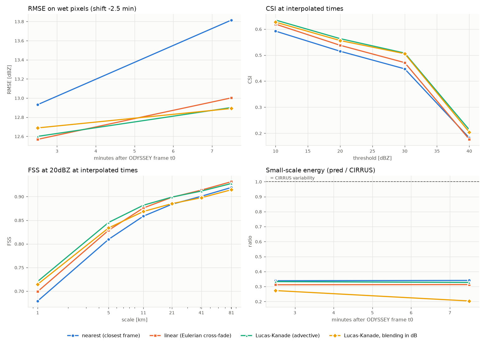

### Degraded CIRRUS as a stand-in for ODYSSEY

To measure the interpolation error over months with a known truth (H1),
CIRRUS is degraded to the ODYSSEY grid (`opera_ds.validate.degrade_frame`) and
kept every 15 min; the degraded frames are interpolated back to 5 min and scored
against the real CIRRUS (`notebooks/02-mr-degraded-cirrus.ipynb`). The
degradation should look like real ODYSSEY, otherwise it measures the error on an
input that is easier or harder to interpolate.

Three degradations of each 2 × 2 block were compared with real ODYSSEY on
1–5/7/2024: mean in linear Z (`zmean`), maximum (`max`) and the upper-left pixel
(`sample`). ODYSSEY at NT is paired with CIRRUS at NT+5, the closest window
([data.md](data.md), *Time windows*); 382 pairs, values capped at 55 dBZ against
the ODYSSEY outliers ([data.md](data.md), *Known problems*). Distributions of wet pixels (≥ 10 dBZ) are compared by
shape, after removing the median offset, since the products differ in level;
small-scale energy is the high-pass energy (Gaussian, σ = 2 px) relative to
ODYSSEY.

| area | variant | median offset to ODYSSEY [dB] | QQ shape RMS [dB] | small-scale energy / ODYSSEY |
|---|---|---:|---:|---:|
| Belgium + 200 km | `zmean` | −0.04 | 0.39 | 1.39 |
| | `max` | 0.70 | 0.78 | 1.63 |
| | `sample` | −0.20 | 0.43 | 1.53 |
| Belgium | `zmean` | 1.30 | 0.67 | 2.13 |
| | `max` | 2.61 | 1.21 | 2.50 |
| | `sample` | 0.86 | 0.63 | 2.25 |

- `zmean` is the closest to ODYSSEY: lowest small-scale energy everywhere, best
  or tied distribution shape. It is the degradation used in H1.
- No degradation is smoother than ODYSSEY: real ODYSSEY has 1.4–2.1 times less
  small-scale energy than CIRRUS degraded by `zmean`. Degraded CIRRUS is
  therefore a rougher, not an easier, input than ODYSSEY.
- The OPERA product sheet describes the composite value as the maximum of all
  contributing single-scan pixels
  ([summary](sources/2024%20-%20EUMETNET%20-%20OPERA%20CIRRUS%20maximum%20reflectivity%20composite%20user%20product%20sheet.md)),
  which is closer to the `max` degradation; yet `zmean` matches real ODYSSEY
  better. This is measured, not explained.

### Convective and stratiform pixels

Scores can be split by precipitation type on each pixel of the truth, so no
label per time is needed (`opera_ds/classify.py`, option `classifier` of
`run_validation`). The rule is Steiner et al. (1995)
([summary](sources/1995%20-%20Steiner%20-%20Climatological%20characterization%20of%20three-dimensional%20storm%20structure%20from%20operational%20radar%20and%20rain%20gauge%20data.md)),
with its published parameters:

| parameter | value | source |
|---|---|---|
| convective centre by intensity | ≥ 40 dBZ | Steiner 1995, section 6c; also the RMI storm threshold in Belgium, Goudenhoofdt and Delobbe 2013 ([summary](sources/2013%20-%20Goudenhoofdt%20-%20Statistical%20characteristics%20of%20convective%20storms%20in%20Belgium%20derived%20from%20volumetric%20weather%20radar%20observations.md)) |
| background | mean in linear Z of the echo pixels within 11 km | Steiner 1995, section 6c |
| convective centre by peakedness | above the background by ΔZ = 10 dB below 0 dBZ, 10 − Z_bg²/180 up to 42.43 dBZ, 0 above | Steiner 1995, Eq. 2 |
| convective radius around a centre | 1 km below 25 dBZ of background, then 2, 3, 4 km every 5 dBZ, 5 km from 40 dBZ | Steiner 1995, Fig. 6b, "medium" |
| grid | 2 km: the 1 km truth is degraded by `zmean`, classified, and each 2 km class copied to its 2 × 2 block | the parameters were tuned on 2 km, and a finer grid gives too much convective area (Steiner 1995, section 6d) |

Echo pixels are those above the floor of the validation fields; everything with
echo that is not convective is stratiform. 2 km is also the ODYSSEY grid, so the
same classification can run on the archive.

Convective share of the echo area over Belgium on the H1 test week
(8–14/9/2025, 2,016 wet CIRRUS times), against Steiner 1995, Table 3 (Darwin,
February 1988, 2 km):

| grid | convective area | this week | Steiner 1995 |
|---|---|---:|---:|
| 1 km | medium radius | 25.4% | — |
| 2 km | medium radius | 21.3% | 12% (case 2d) |
| 2 km | centres only | 9.0% | 3% (case 2b) |

- The 1 km grid gives a larger convective share than 2 km, as section 6d
  reports; this is the reason for the 2 km grid.
- The radius takes the convective share from 9.0% to 21.3% (×2.4), while in
  the paper it goes from 3% to 12% (×4). The excess over Steiner is in the
  centres (×3), not in the radius. A Darwin month and a Belgian September week
  are not directly comparable.

Known limits: the method was tuned on a tropical radar at a fixed 3 km height.
OPERA `DBZH` is a maximum-reflectivity composite, so a bright band above
40 dBZ can be labelled convective, mostly in the cold season. Check over
Belgium, Steiner at 2 km, all CIRRUS frames of each period, convective centres
counted on the 2 km grid (`steiner_centres`):

| period | convective share of the echo area | centres by intensity (≥ 40 dBZ) | centres by peakedness only |
|---|---:|---:|---:|
| 8–14/9/2025 | 21.3% | 373,440 (79.5%) | 96,386 (20.5%) |
| January 2025 | 14.5% | 621,204 (67.1%) | 305,013 (32.9%) |

As a second opinion, the intensity centres were classified with ECCO
(Dixon and Romatschke 2022,
[summary](sources/2022%20-%20Dixon%20-%20Three-dimensional%20convective-stratiform%20echo-type%20classification%20and%20convectivity%20retrieval%20from%20radar%20reflectivity.md)),
which separates echo types by horizontal texture, not intensity, with its OPERA
2 km parameters (`ecco_convectivity`, `notebooks/03-mr-cirrus-analysis.ipynb`).
ECCO has no winter validation and its authors report bright band classified as
convective (section 6), so it is not a referee. Belgium, all CIRRUS frames:

| month | Steiner intensity centres | ECCO stratiform (< 0.4) | ECCO mixed (0.4–0.5) |
|---|---:|---:|---:|
| January 2025 | 621,204 | 6.4% | 14.3% |
| September 2025 | 756,918 | 13.9% | 22.6% |

The question is real: OPERA applies no vertical-profile correction, so a bright
band can reach the composite (Saltikoff et al. 2019, section 4,
[summary](sources/2019%20-%20Saltikoff%20-%20OPERA%20the%20Radar%20Project.md)).
But over the month ECCO does not point to more bright band in January than in
September.

Maps of the 15 January times with most disagreements (intensity centres that
ECCO calls stratiform; that they all fall on one evening is a consequence of
this selection rule, not a finding, and one episode cannot tell how common it
is), all on the evening of 22/1/2025 (21:35–22:45, frames
15 min before and after, radar positions from the single-radar files of that
day): over Belgium, a wide patch of Steiner convective pixels centred near the
radars behel and bewid hardly moves between 21:20 and 23:00, while ECCO calls
it stratiform; it is a patch, not a ring around a radar. Over France, elongated cells
move north-east from frame to frame and both methods call them convective. The
stationary area looks like a bright band rather than convection; this is a
single episode, not a conclusion.

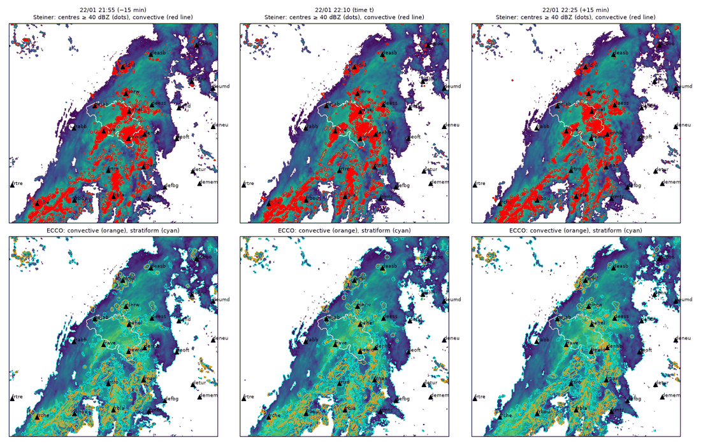

Where the January `lk` deficit on convective pixels comes from
(`notebooks/03-mr-cirrus-analysis.ipynb`, section 4): `lk` is worse than
`linear` on 22 of 28 days, but five days carry 70% of the monthly deficit (24,
5, 25, 22 and 30 January; the first three 51%). One time per day, the one where
`lk` loses most against `linear`, was mapped for these five days. On all of
them, patches (not rings) of Steiner convective pixels stay centred on or near
radars (behel, bewid, bejab, nldhl, nlhrw; not every radar on every day)
through the three frames while the surrounding rain moves; around nldhl ECCO
also draws a convective ring. The `lk` deficit is concentrated on days with
stationary features centred on radars, consistent with `lk` moving stationary
features that `linear` leaves in place; not tested. Described without a
threshold; these maps show where the deficit comes from, not how the features
are produced. On 24/1 the top panels also show a straight line east of nldhl,
which looks like a radial spike from interference. What these features are is
left to H2 (#19), which catalogues radar artefacts.

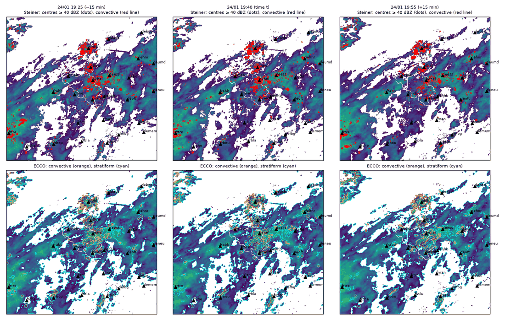

Season (December–February against June–August) is kept as a
second, coarse split, as in Imhoff et al. (2020)
([summary](sources/2020%20-%20Imhoff%20-%20Spatial%20and%20temporal%20evaluation%20of%20radar%20rainfall%20nowcasting%20techniques%20on%201,533%20events.md)),
where summer nowcast errors are about three times the winter ones.

### Interpolation error on degraded CIRRUS (H1)

Set-up (`notebooks/02-mr-degraded-cirrus.ipynb`): CIRRUS degraded by `zmean`
at :00, :15, :30, :45, interpolated back to 5 min by `nearest`, `linear` and
`lk`, and scored against the real CIRRUS over Belgium, with the scores of
`run_validation` and the Steiner classes at 2 km. No time shift: input and
truth come from the same product, so there is no offset to imitate (the
ODYSSEY–CIRRUS offset belongs to H6). Months: January, June, July, September
and October 2025.

RMSEs are on wet pixels, in dBZ. The interpolation error is the extra error over
the floor at `alpha` = 0, in quadrature: √(RMSE_α² − RMSE_0²) at the mean of
α = 1/3 and 2/3, with the ratio RMSE_α / RMSE_0.

| month | pixels | method | α = 0 | α = 1/3 | α = 2/3 | extra | ratio |
|---|---|---|---:|---:|---:|---:|---:|
| January 2025 | all | `nearest` | 2.93 | 6.96 | 7.18 | 6.44 | 2.42 |
| | | `linear` | 2.93 | 6.79 | 6.90 | 6.19 | 2.34 |
| | | `lk` | 2.93 | 6.28 | 6.33 | 5.58 | 2.15 |
| | convective | `nearest` | 4.57 | 7.94 | 8.19 | 6.65 | 1.76 |
| | | `linear` | 4.57 | 7.15 | 7.20 | 5.53 | 1.57 |
| | | `lk` | 4.57 | 8.36 | 8.48 | 7.07 | 1.84 |
| | stratiform | `nearest` | 1.93 | 6.03 | 6.16 | 5.78 | 3.16 |
| | | `linear` | 1.93 | 5.66 | 5.73 | 5.36 | 2.95 |
| | | `lk` | 1.93 | 4.81 | 4.82 | 4.41 | 2.50 |
| June 2025 | all | `nearest` | 3.69 | 8.94 | 9.02 | 8.19 | 2.44 |
| | | `linear` | 3.69 | 8.77 | 8.95 | 8.06 | 2.40 |
| | | `lk` | 3.69 | 7.65 | 7.61 | 6.68 | 2.07 |
| | convective | `nearest` | 4.53 | 9.27 | 9.41 | 8.17 | 2.06 |
| | | `linear` | 4.53 | 8.22 | 8.30 | 6.90 | 1.82 |
| | | `lk` | 4.53 | 7.97 | 8.03 | 6.60 | 1.77 |
| | stratiform | `nearest` | 2.73 | 7.66 | 7.76 | 7.21 | 2.83 |
| | | `linear` | 2.73 | 7.20 | 7.28 | 6.70 | 2.65 |
| | | `lk` | 2.73 | 6.22 | 6.20 | 5.58 | 2.28 |
| July 2025 | all | `nearest` | 4.01 | 8.97 | 9.14 | 8.12 | 2.26 |
| | | `linear` | 4.01 | 9.02 | 9.08 | 8.11 | 2.25 |
| | | `lk` | 4.01 | 7.70 | 7.65 | 6.54 | 1.91 |
| | convective | `nearest` | 4.27 | 9.09 | 9.09 | 8.02 | 2.13 |
| | | `linear` | 4.27 | 8.15 | 8.22 | 6.98 | 1.92 |
| | | `lk` | 4.27 | 7.28 | 7.27 | 5.89 | 1.70 |
| | stratiform | `nearest` | 2.98 | 7.62 | 7.71 | 7.06 | 2.57 |
| | | `linear` | 2.98 | 7.26 | 7.32 | 6.65 | 2.45 |
| | | `lk` | 2.98 | 6.22 | 6.19 | 5.45 | 2.08 |
| September 2025 | all | `nearest` | 3.75 | 8.60 | 8.67 | 7.78 | 2.30 |
| | | `linear` | 3.75 | 8.45 | 8.55 | 7.62 | 2.26 |
| | | `lk` | 3.75 | 7.41 | 7.41 | 6.39 | 1.97 |
| | convective | `nearest` | 4.55 | 9.10 | 9.31 | 8.01 | 2.03 |
| | | `linear` | 4.55 | 8.08 | 8.09 | 6.69 | 1.78 |
| | | `lk` | 4.55 | 7.77 | 7.77 | 6.31 | 1.71 |
| | stratiform | `nearest` | 2.81 | 7.25 | 7.30 | 6.71 | 2.59 |
| | | `linear` | 2.81 | 6.78 | 6.81 | 6.19 | 2.42 |
| | | `lk` | 2.81 | 5.98 | 5.97 | 5.27 | 2.13 |
| October 2025 | all | `nearest` | 3.55 | 8.78 | 8.86 | 8.08 | 2.49 |
| | | `linear` | 3.55 | 8.58 | 8.66 | 7.86 | 2.43 |
| | | `lk` | 3.55 | 7.45 | 7.40 | 6.52 | 2.09 |
| | convective | `nearest` | 4.65 | 9.19 | 9.28 | 7.98 | 1.99 |
| | | `linear` | 4.65 | 8.03 | 8.04 | 6.55 | 1.73 |
| | | `lk` | 4.65 | 8.30 | 8.28 | 6.87 | 1.78 |
| | stratiform | `nearest` | 2.61 | 7.57 | 7.65 | 7.15 | 2.91 |
| | | `linear` | 2.61 | 7.08 | 7.11 | 6.59 | 2.71 |
| | | `lk` | 2.61 | 5.98 | 5.93 | 5.35 | 2.28 |

Days in the by-day counts (28 in January, 30 in October): no CIRRUS file is
missing on the left-out days (288 a day). On 17/1 no time is wet by the
criterion of `run_validation` (≥ 10 dBZ on at least 0.2% of the covered
area), and on 16/1, 18/1 and 14/10 no interpolated time has convective pixels.

By season (seasons as in Imhoff et al. 2020; RMSEs pooled over the months of
the season, weighted by the number of wet pixels; DJF is January alone):

| season | pixels | `nearest` | `linear` | `lk` |
|---|---|---:|---:|---:|
| DJF (January) | all | 6.44 | 6.19 | 5.58 |
| | convective | 6.65 | 5.53 | 7.07 |
| | stratiform | 5.78 | 5.36 | 4.41 |
| JJA (June, July) | all | 8.15 | 8.09 | 6.60 |
| | convective | 8.08 | 6.95 | 6.16 |
| | stratiform | 7.13 | 6.68 | 5.51 |
| SON (September, October) | all | 7.93 | 7.74 | 6.46 |
| | convective | 7.99 | 6.62 | 6.59 |
| | stratiform | 6.94 | 6.40 | 5.31 |
| all five months | all | 7.61 | 7.46 | 6.28 |
| | convective | 7.72 | 6.50 | 6.56 |
| | stratiform | 6.67 | 6.19 | 5.12 |

(extra error in dBZ, as defined above.)

- January and October: `lk` has the lowest extra error over all pixels and on
  stratiform pixels; on convective pixels its extra error is higher than
  `linear`'s.
- June, July and September: `lk` has the lowest extra error over all pixels
  and in both classes.
- October `lk` deficit on convective pixels, counted by day as for January:
  `lk` is worse than `linear` on 22 of 30 days, and the deficit is
  concentrated on a few days (28/10 alone carries 63% of the monthly deficit,
  28/10 and 3/10 more than all of it, because `lk` is better than `linear`
  on 8 of the 30 days). The October days were not mapped, so nothing is said about the
  features on them.
- Against the 4 days of real ODYSSEY (1–5/7/2024, shift 0, *Results on
  1–5/7/2024*), compared with the same season, July 2025: the interpolated
  times there have RMSEs of 12.6–13.8 dBZ, against 7.7–9.1 dBZ for degraded
  CIRRUS. The gap is not only interpolation: real ODYSSEY also adds the
  differences between the products and the time offset (with the same label,
  ODYSSEY covers [NT−10, NT+5] and CIRRUS (NT−10, NT], [data.md](data.md),
  *Time windows for the label NT*), which belong to H6. The real ODYSSEY run
  has no `alpha` = 0, because CIRRUS is missing at the quarter hours on those
  days.

Scores by scale (same runs; `alpha` = 0, the floor, is the same for all
methods; `alpha` = 2/3 differs from 1/3 by at most 0.005 in FSS and 0.052 mm/h
in the R errors, so only 1/3 is shown). FSS by window size, the window being
the side of the square in km:

FSS at 20 dBZ

| month | method, `alpha` | 1 km | 5 km | 11 km | 21 km | 41 km | 81 km |
|---|---|---:|---:|---:|---:|---:|---:|
| January 2025 | all, 0 | 0.963 | 0.996 | 0.999 | 0.999 | 1.000 | 1.000 |
| | `nearest`, 1/3 | 0.875 | 0.945 | 0.973 | 0.988 | 0.995 | 0.998 |
| | `linear`, 1/3 | 0.882 | 0.947 | 0.973 | 0.987 | 0.993 | 0.995 |
| | `lk`, 1/3 | 0.912 | 0.973 | 0.989 | 0.994 | 0.997 | 0.998 |
| June 2025 | all, 0 | 0.943 | 0.994 | 0.998 | 0.999 | 0.999 | 1.000 |
| | `nearest`, 1/3 | 0.807 | 0.913 | 0.958 | 0.980 | 0.992 | 0.996 |
| | `linear`, 1/3 | 0.813 | 0.914 | 0.957 | 0.978 | 0.987 | 0.991 |
| | `lk`, 1/3 | 0.861 | 0.957 | 0.982 | 0.991 | 0.995 | 0.997 |
| July 2025 | all, 0 | 0.939 | 0.994 | 0.998 | 0.999 | 0.999 | 0.999 |
| | `nearest`, 1/3 | 0.824 | 0.934 | 0.971 | 0.986 | 0.994 | 0.997 |
| | `linear`, 1/3 | 0.829 | 0.933 | 0.968 | 0.982 | 0.987 | 0.990 |
| | `lk`, 1/3 | 0.868 | 0.963 | 0.984 | 0.991 | 0.995 | 0.996 |
| September 2025 | all, 0 | 0.930 | 0.992 | 0.997 | 0.999 | 0.999 | 1.000 |
| | `nearest`, 1/3 | 0.797 | 0.914 | 0.958 | 0.980 | 0.991 | 0.996 |
| | `linear`, 1/3 | 0.806 | 0.917 | 0.959 | 0.979 | 0.988 | 0.991 |
| | `lk`, 1/3 | 0.842 | 0.953 | 0.980 | 0.990 | 0.995 | 0.996 |
| October 2025 | all, 0 | 0.941 | 0.994 | 0.998 | 0.999 | 0.999 | 1.000 |
| | `nearest`, 1/3 | 0.806 | 0.912 | 0.958 | 0.980 | 0.992 | 0.996 |
| | `linear`, 1/3 | 0.814 | 0.913 | 0.956 | 0.978 | 0.987 | 0.990 |
| | `lk`, 1/3 | 0.859 | 0.954 | 0.980 | 0.990 | 0.994 | 0.996 |

FSS at 30 dBZ

| month | method, `alpha` | 1 km | 5 km | 11 km | 21 km | 41 km | 81 km |
|---|---|---:|---:|---:|---:|---:|---:|
| January 2025 | all, 0 | 0.914 | 0.990 | 0.996 | 0.998 | 0.999 | 0.999 |
| | `nearest`, 1/3 | 0.735 | 0.872 | 0.934 | 0.969 | 0.987 | 0.994 |
| | `linear`, 1/3 | 0.750 | 0.882 | 0.941 | 0.974 | 0.988 | 0.993 |
| | `lk`, 1/3 | 0.793 | 0.931 | 0.971 | 0.986 | 0.992 | 0.995 |
| June 2025 | all, 0 | 0.928 | 0.992 | 0.997 | 0.999 | 0.999 | 1.000 |
| | `nearest`, 1/3 | 0.744 | 0.878 | 0.940 | 0.972 | 0.988 | 0.995 |
| | `linear`, 1/3 | 0.758 | 0.887 | 0.947 | 0.976 | 0.987 | 0.992 |
| | `lk`, 1/3 | 0.821 | 0.945 | 0.978 | 0.990 | 0.995 | 0.997 |
| July 2025 | all, 0 | 0.926 | 0.993 | 0.997 | 0.999 | 0.999 | 0.999 |
| | `nearest`, 1/3 | 0.771 | 0.910 | 0.959 | 0.981 | 0.992 | 0.996 |
| | `linear`, 1/3 | 0.783 | 0.915 | 0.961 | 0.979 | 0.986 | 0.989 |
| | `lk`, 1/3 | 0.838 | 0.955 | 0.981 | 0.989 | 0.994 | 0.995 |
| September 2025 | all, 0 | 0.924 | 0.992 | 0.997 | 0.999 | 0.999 | 1.000 |
| | `nearest`, 1/3 | 0.753 | 0.887 | 0.945 | 0.974 | 0.989 | 0.995 |
| | `linear`, 1/3 | 0.766 | 0.895 | 0.950 | 0.977 | 0.987 | 0.991 |
| | `lk`, 1/3 | 0.822 | 0.947 | 0.979 | 0.990 | 0.995 | 0.997 |
| October 2025 | all, 0 | 0.906 | 0.990 | 0.996 | 0.998 | 0.999 | 0.999 |
| | `nearest`, 1/3 | 0.686 | 0.841 | 0.919 | 0.962 | 0.983 | 0.992 |
| | `linear`, 1/3 | 0.699 | 0.851 | 0.926 | 0.966 | 0.982 | 0.988 |
| | `lk`, 1/3 | 0.769 | 0.920 | 0.966 | 0.983 | 0.990 | 0.993 |

RMSE of R (mm/h) on blocks of the given size:

| month | method, `alpha` | 1 km | 2 km | 5 km | 10 km | 25 km |
|---|---|---:|---:|---:|---:|---:|
| January 2025 | all, 0 | 1.65 | 0.76 | 0.48 | 0.32 | 0.22 |
| | `nearest`, 1/3 | 2.67 | 2.14 | 1.46 | 0.99 | 0.53 |
| | `linear`, 1/3 | 2.47 | 1.91 | 1.30 | 0.87 | 0.43 |
| | `lk`, 1/3 | 3.19 | 2.57 | 1.65 | 0.93 | 0.45 |
| June 2025 | all, 0 | 0.99 | 0.44 | 0.30 | 0.19 | 0.13 |
| | `nearest`, 1/3 | 2.36 | 2.10 | 1.60 | 1.09 | 0.56 |
| | `linear`, 1/3 | 2.19 | 1.91 | 1.43 | 0.92 | 0.42 |
| | `lk`, 1/3 | 2.03 | 1.66 | 1.15 | 0.67 | 0.35 |
| July 2025 | all, 0 | 1.20 | 0.51 | 0.33 | 0.22 | 0.15 |
| | `nearest`, 1/3 | 2.92 | 2.59 | 1.90 | 1.24 | 0.60 |
| | `linear`, 1/3 | 2.68 | 2.33 | 1.66 | 1.02 | 0.46 |
| | `lk`, 1/3 | 2.46 | 1.99 | 1.33 | 0.82 | 0.41 |
| September 2025 | all, 0 | 1.18 | 0.53 | 0.34 | 0.22 | 0.14 |
| | `nearest`, 1/3 | 2.65 | 2.34 | 1.76 | 1.20 | 0.58 |
| | `linear`, 1/3 | 2.44 | 2.11 | 1.57 | 1.02 | 0.43 |
| | `lk`, 1/3 | 2.30 | 1.84 | 1.22 | 0.72 | 0.36 |
| October 2025 | all, 0 | 1.17 | 0.52 | 0.33 | 0.21 | 0.14 |
| | `nearest`, 1/3 | 2.21 | 1.86 | 1.34 | 0.92 | 0.47 |
| | `linear`, 1/3 | 2.02 | 1.66 | 1.18 | 0.79 | 0.36 |
| | `lk`, 1/3 | 2.35 | 1.90 | 1.26 | 0.72 | 0.34 |

- FSS: `lk` has the highest FSS at every window up to 41 km, at both
  thresholds and in all five months. At 81 km the three methods differ by at
  most 0.007 and `nearest` equals `lk` or exceeds it by 0.001 in some months.
- R errors: `lk` has the lowest RMSE at every block size in June, July and
  September. In January it is higher than `linear` at every block size; in
  October it is higher at 1, 2 and 5 km and lower at 10 and 25 km.

**Conclusion.** Over the five months, `lk` has the lowest extra error in dBZ
over all pixels and on stratiform pixels in every month, and on convective
pixels in June, July and September. On convective pixels in January and
October `linear` is lower; in both months the deficit is concentrated on a few
days. In January the maps of those days show stationary features centred on
or near radars, consistent with `lk` moving stationary features that `linear`
leaves in place (not tested; what the features are is left to H2, #19); the
October days were not mapped. The same two months are the ones where `lk`
loses against `linear` in the R errors: in January at every block size up to
25 km, in October at 1, 2 and 5 km.

### Synthetic test

`tests/test_synthetic.py` builds a multiscale field with known motion
(translation and rotation, about 60 km/h) and growth/decay, degrades it to
"ODYSSEY" (2 km, 15 min, shifted by +2.5 min) and uses it as "CIRRUS" at
1 km / 5 min. It requires that the estimated shift is −2.5 min, that LK beats
`nearest` and `linear` in RMSE at every interpolated time and `linear` in CSI at
30 dBZ, that the volume stays within 2% of "ODYSSEY" at every `alpha` and the
2 × 2 block error at `alpha = 0` is below 1%, and that the sampler and the
window store behave as specified below.

## Cleaning of ODYSSEY (H2)

### Methods in the literature

Collected before any map or threshold, as asked in the review of #73: the
methods most used to clean radar data of the artefact types of H2 (#19), with
EURADCLIM as the model. Each row gives the artefact, the input and whether it
can run on our data, the 2 km / 15 min ODYSSEY `DBZH` composite with `QIND`
(no single-radar volumes). The choice of methods comes after this table.

| method | source | artefact | input | on the ODYSSEY composite |
|---|---|---|---|---|
| cap or discard values above a threshold; or flag whole composites with extreme radar–gauge ratios | Overeem et al. 2023, section 4.3 | impossible values | one composite; gauges for the second option | yes; the authors call the threshold "a bit arbitrary" |
| Gabella filter: in a 5 × 5 window, fewer than 6 neighbours less than 6 dB below the centre; or echo area / perimeter below 1.3 | Gabella and Notarpietro 2002, section 2; Overeem et al. 2023, section 3.1; wradlib `classify.filter_gabella` (Heistermann et al. 2013) | residual clutter, anaprop, isolated echoes, sea clutter, thin spokes and rings | one composite | yes (EURADCLIM ran it on the ODYSSEY rain-rate composite); developed on single-radar 1 km maps, so at 2 km the window is 10 km and the smallest kept echo about 44 km² |
| satellite cloud-type mask: zero where the whole 7 × 7 window is cloud-free or thin high cloud | Overeem et al. 2023, sections 2.3, 3.2 | echoes without rain; also lowers interference | composite + MSG cloud type (CLAAS-2) | yes, with satellite data |
| satellite filter of the OPERA data centre (NWC SAF precipitating clouds) | Saltikoff et al. 2019, section 2.2 | echoes without rain | — | already in ODYSSEY since late 2015 |
| `histo_cut` on the annual sum: tails of the histogram below 5% of the most frequent class; hourly values interpolated where lower | Overeem et al. 2023, section 3.3; wradlib `classify.histo_cut` | fixed clutter (high tail), shading or blockage (low tail) | one year of composites | yes |
| per-pixel frequency of reflectivity classes over years; flagged pixels plus a 2 km buffer interpolated from clean pixels 10–20 km away | Wagner et al. 2012, sections 3, 5.2 | fixed clutter (excess and filter holes) | long series | yes |
| spokes from the median frequency per 1° azimuth (edge: jump above 10%), scaled by the neighbouring 20–30 azimuths (factors 1.1–1.5) | Wagner et al. 2012, sections 3, 5.2 | blocked sectors; aircraft spokes | long series + radar position | possible with radar positions; one radar only in the paper, overlap of radars not treated |
| beam-blockage correction (blockage above 70% set to nodata) and monthly hit-accumulation clutter filter of the OPERA data centre | Saltikoff et al. 2019, section 2.2 | blocked sectors, fixed clutter | — | already in ODYSSEY (blockage since late 2015) |
| monthly count of exceedances of 1 mm in 10 min per pixel; more than 200 a month marks permanent clutter | Ośródka and Szturc 2022, section 5 | fixed clutter (diagnostic) | long series | yes, as a diagnostic; the rate threshold is for 10 min data |
| TURBINE: static mask from accumulations of dry time steps, checked by hand | Ośródka and Szturc 2022, section 3.4 | fixed clutter (wind farms, buildings) | long series | the idea yes; no threshold given |
| SPECK: a pixel with fewer than 3 echo pixels in its 3 × 3 window is removed, an empty pixel with fewer than 3 empty ones is filled; run twice | Ośródka et al. 2014, section 2.4.2 | isolated echoes (and isolated holes) | one image | yes as an operation; set on 1° × 1 km polar gates, not 2 km cells |
| SPIKE ("wide": variance across ±3° above 1000 and along ±15 km below 5 on more than 45% of a ray; "narrow": up to 7° wide, neighbours 10 dB lower on more than 25% of a ray; three more tests added in 2022) | Ośródka et al. 2014, section 2.4.1; Ośródka and Szturc 2022, section 3.5 | interference spikes; the "inverse" test, blocked sectors | single-radar polar volume | no |
| DP.TURBINE, DP.NMET (fuzzy logic and decision tree on ρHV, ZDR, ΦDP) | Ośródka and Szturc 2022, sections 3.2–3.3 | fixed clutter, echoes without rain | polarimetric single-radar volume | no |
| SPECK: segment size by flood fill, 50% anomaly probability at 12 pixels | Peura 2002, section 3.2 | isolated echoes | one image | yes as an operation; the 12 pixels are polar bins, not 2 km cells |
| EMITTER, SUN, SHIP, BIOMET (line segments along the beam, sidelobes, beam height) | Peura 2002, sections 3.1–3.4 | interference spikes, sun, ships, birds and insects | single-radar polar scan | no; EMITTER thresholds not given |
| radial image processing with interpolation from neighbouring radials; dual-polarisation identification; receiver filters | Saltikoff et al. 2016 (citing Peura 2002 and others) | interference spikes | single-radar polar data or raw signal | no |

What the collection shows:

- **Five of the six artefact types have a method that runs on a composite:**
  isolated echoes (Gabella, SPECK), fixed clutter and blocked sectors (long-series
  statistics: `histo_cut`, Wagner et al.), echoes without rain (satellite
  mask), and impossible values, but for these only a threshold whose value the
  literature leaves open.
- **Interference spikes have no composite method in these sources.** The
  dedicated methods need single-radar rays, and the interference changes from
  scan to scan, so a fixed mask does not catch it (Saltikoff et al. 2016).
  In EURADCLIM the Gabella filter, the satellite mask and the static mask
  together reduce it.
- **Part of the cleaning is already in ODYSSEY** (Saltikoff et al. 2019): the
  satellite filter, beam-blockage correction and a clutter filter, since late
  2015. The archive before and after that date is therefore cleaned
  differently. `QIND` is the minimum of the three quality indices of these
  steps, weighted by distance and beam height; this bears on whether `QIND` is
  needed (#19).
- **The Gabella defaults** of wradlib (5 × 5 window, 6 dB, 1.3) are those of
  the original paper, except `n_p` = 6, which the paper leaves within 6–10.
- **No method in these sources removes echoes without rain on a composite
  without satellite data**; RADVOL-QC lists them but treats them only with
  polarimetric variables (2022).
- Gabella and Notarpietro (2002) and Peura (2002) are no longer online at the
  ERAD address; the copies read are Internet Archive snapshots.

### Choice (review of #74)

- **Rule for all of H2** ([roadmap.md](roadmap.md), *Constraints*): every step
  that CIRRUS goes through uses only real-time data, that is the composite and
  masks or statistics computed beforehand from past composites. Satellite
  data, gauges and national products only validate, or make ODYSSEY look like
  CIRRUS. The aim is to match CIRRUS, not to be cleaner than it.
- **Methods:** EURADCLIM: Gabella on each composite, `histo_cut` on annual
  sums; Wagner-style frequency maps for the catalogue. `histo_cut` and the
  frequency maps fit the rule when the mask is computed on past composites and
  applied to new ones.
- **Static mask of the first version** (review of #74, 10/11/2026). On our
  maximum composite, `histo_cut` on the annual sum flags discs that sit on the
  radars: they are the excess near each radar, not clutter (*Catalogue:
  ODYSSEY 2013–2024*). So the static mask is based on the frequency maps
  (Wagner et al. 2012) and on the points above 70 dBZ.
  - **Rule:** ≥ 55 dBZ in at least 1% of the valid times, or > 70 dBZ in at
    least 0.1%. The thresholds are ours (*Static mask: rules in the
    literature*).
  - **Periods:** the mask is computed per period, split at December 2015 and
    August 2018.
  - **Per radar:** each pixel is attached to its nearest radar within 20 km
    and switched on or off with `how/nodes`. The 20 km are ours, not from the
    literature: 31 of the 44 discs of *Catalogue: ODYSSEY 2013–2024* are
    centred within 20 km of a radar.
  - **Fill:** masked pixels are filled as in EURADCLIM.
  - **CIRRUS:** the mask comes from past CIRRUS composites, not from
    ODYSSEY.
- **Satellite mask:** not in the operational chain, and left out of the
  first version (review of #74: first a result on the composite alone, then
  improvements). A possible later improvement for ODYSSEY 2012–2015 only, to
  judge once the first version shows whether there is a gap before and after
  late 2015 (when the OPERA satellite filter started; Saltikoff et al. 2019).
  It would need the CLAAS-2.1 cloud type, which is available only through
  the CM SAF help desk (`data.md`, CLAAS-3 row).
- **Rolling-window mask** (first refinement after the first version, review
  of #74). The static mask is recomputed on a rolling window of past
  composites, which fits the real-time rule.
  - On CIRRUS 2025, 132 pixels (297 without Gabella) still have ≥ 55 dBZ in
    more than 1% of the times: they are fixed points that the 2024 mask does
    not know (*CIRRUS 2025, out of sample*).
  - A rolling mask would also cover the 57% of the CIRRUS mask pixels that
    are more than 20 km from any radar. These stay on even when the radar
    that sees them is off.
- **Wind turbines** (possible improvement after the first version): if fixed
  points above 70 dBZ remain, turbine positions could check them or give a
  static mask, which the real-time rule allows. Open pan-European sources:
  OpenStreetMap (`generator:source=wind`, ODbL) and the EMODnet offshore wind
  farms; construction dates would be needed for 2012–2024.
- **Calibration drift** (possible improvement after the first version,
  review of #74). Radar hardware ages, and a radar can lose sensitivity for
  months before it is switched off.
  - The monthly statistics would show such a drift where a radar covers the
    area alone.
  - The fixed points above 70 dBZ could serve as stable targets to follow the
    radar's calibration. This is the relative calibration adjustment
    (Silberstein et al. 2008): the 95th percentile of the reflectivity of
    clutter targets is tracked day by day, and it stays within about ±1 dB.
  - Wolff et al. (2015) turn it into a general recipe. The clutter map has
    the cells above 55 dBZ in at least 50% of the scans of one dry day, at
    1–5 km from the radar. Their daily value varies by 0.13 dB (standard
    deviation), and a change of 0.05° in elevation shows as about 0.5 dB.
  - Vaccarono et al. (2016) apply the same idea to two operational C-band
    radars and detect changes of about 2 dB.
  - Both work on single-radar data, not on a composite.
- **Priority:** first a working cleaning on the composite alone (impossible
  values, Gabella, `histo_cut`, frequency maps for the catalogue) on ODYSSEY
  and CIRRUS, with numbers before and after; improvements come after.
- **Interference spikes:** only reduced, but the residual after cleaning is to
  be measured.
- **Gabella:** fits the rule. Its loss of convective rain is to be weighed
  against what it removes of the stationary features of January 2025, with
  the position of the removed pixels, at 2 km and at 1 km on CIRRUS.
  Kept in the first version (review of #74, 10/11/2026). It is most of
  what the first version removes, while it mostly trims the peaks of real
  cells and reduces the spoke edges by only 11%. So every before/after is
  reported with and without Gabella. The final choice is made later, against
  a reference (RADCLIM or VMM, H5).
- **Impossible values:** a threshold fits the rule; 70 dBZ as a cited
  convention (Fluck et al. 2021), separate from the 55 dBZ cap (*Conventions*),
  after counting the pixels between 55 and 70 dBZ and above 70 on ODYSSEY and
  CIRRUS.
- **`QIND`: left out** (review of #74, 10/11/2026). The crops are not redone
  with the quality bands. CIRRUS has no equivalent: its `quality1` is almost
  binary and its meaning is unclear (`data.md`, *Quality fields*). So a mask
  built on `QIND` could not run in the operational chain, and it would make
  ODYSSEY less like CIRRUS, not more.
- **Sea clutter and anomalous propagation:** a seventh type, only for what the
  single-radar processing upstream leaves; the speckle filter on the
  composite, the satellite mask only for ODYSSEY before late 2015.

### Summary: each artefact type, its method and its example

The H2 ticket (#19) asks, for each type of artefact, for a method or a
written reason to leave it. This table collects the answers. The details
and the numbers are in the sections below.

| artefact type | first version | example in the catalogue (notebook 05) | what is left, or why it is left |
|---|---|---|---|
| impossible values | > 70 dBZ set to no rain (Fluck et al. 2021) | values ≥ 100 dBZ at fixed points (sections 3, 4) | 0.2% of the values above 70 dBZ stay, all exactly 70.0 dBZ |
| fixed clutter | static mask: ≥ 55 dBZ in ≥ 1% or > 70 dBZ in ≥ 0.1% of the times, per period and per radar, EURADCLIM fill | fixed points and discs (sections 4, 5) | discs with no radar, probably wind farms: later option |
| interference spikes | Gabella (EURADCLIM) | radial lines in the south-east (sections 4, 8) | spoke edges −11% with Gabella; the rest stays (*Choice*: only reduced) |
| blocked sectors | none | none with sharp edges (section 8) | the maximum composite fills them, and OPERA corrects blockage since late 2015 |
| isolated echoes | Gabella (shape test) | 1.2% of the echo pixel-times of 2023 (section 8) | measured, not yet compared before and after |
| echoes without rain | none in the first version; OPERA's satellite filter upstream since December 2015 | summer excess near the radars until 2015 (section 7) | satellite mask for 2013–2015 as a later option |
| sea clutter, anomalous propagation | Gabella and the static mask | lines over the North Sea (sections 4, 9) | most lines go with Gabella; without it, 30 pixels stay in 2023 |

`QIND` is left out (*Choice*): CIRRUS has no equivalent field, so it could not
run in the operational chain.

### Impossible values: discard threshold in the literature

Asked in the review of #74: an upper limit to discard reflectivity, separate
from the 55 dBZ cap.

| threshold | source | product | condition |
|---|---|---|---|
| above 70 dBZ set to missing | Fluck et al. 2021, section 3.1 | Météo-France and DWD 2D composites, 1 km / 5 min, 2005–2014 (the French mosaic covers much of Belgium) | none; with a neighbour-difference test, a single-scan spike test and a lightning filter; the value is not justified |
| at least 75 dBZ set to missing | Charba and Liang 2005, sections 3–4 | US 2 km national mosaic of maxima | only without lightning; 75 dBZ is the top category of that product |
| median storm maximum 69 dBZ; 26 of 568 storms reached 75 dBZ | Blair et al. 2011 | WSR-88D (S band), giant-hail storms | physical extreme, not a QC rule |
| only lower thresholds | Scovell et al. 2013; OPERA product sheet 2024 | ODYSSEY quality control | none of the OPERA documents gives an upper valid limit |

There is no standard: one unconditional precedent at 70 dBZ, on composites
that cover Belgium, and a conditional one at 75 dBZ. Both lie well above the
55 dBZ cap and well below the values seen in ODYSSEY (100 dBZ and more,
128 dBZ). Any choice is a cited convention, not an established limit (#19).

### Impossible values: counts on ODYSSEY and CIRRUS

Asked in the review of #74 before fixing 70 dBZ. Echo pixels (covered, not
`undetect`) of the Belgian crops on the project PC: ODYSSEY 2023 (2 km,
15 min, 34,408 files) and CIRRUS 2025 (1 km, 5 min, 103,791 files).

| product | echo pixels | 55–70 dBZ | above 70 dBZ | of which ≥ 100 dBZ | files with any pixel above 70 |
|---|---:|---:|---:|---:|---:|
| ODYSSEY 2023 | 1.87 × 10⁹ | 1,415,933 (7.6 × 10⁻⁴) | 47,310 (2.5 × 10⁻⁵) | 28,876 | 10,112 (29.4%) |
| CIRRUS 2025 | 1.98 × 10¹⁰ | 17,806,147 (9.0 × 10⁻⁴) | 488,997 (2.5 × 10⁻⁵) | 27 | 24,287 (23.4%) |

- **Same share above 70 dBZ.** The share above 70 dBZ is the same in both
  products, 2.5 × 10⁻⁵.
- **ODYSSEY's extremes are impossible values; CIRRUS's are not.** In ODYSSEY,
  61% of the pixels above 70 dBZ are at 100 dBZ or more. In CIRRUS almost none
  are (27 pixels).
- **Above 70 dBZ is frequent.** About a quarter of the files of both products
  have at least one pixel above 70 dBZ. Where these pixels lie (hail cores or
  fixed points) is not checked; a frequency map would show it.

### Where the values above 70 dBZ lie

Per-pixel count of the times above 70 dBZ over the same files as the counts
above (exploration script; the arrays are in `results/h2_artefacts/`).

| product | crop pixels ever above 70 dBZ | pixels above 70 dBZ at least 100 times | their share of all the counts |
|---|---:|---:|---:|
| ODYSSEY 2023 (2 km) | 4,465 of 238,522 | 15 (4 of them at least 1,000 times) | 64% |
| CIRRUS 2025 (1 km) | 54,794 of 954,088 | 899 (25 of them at least 1,000 times) | 58% |

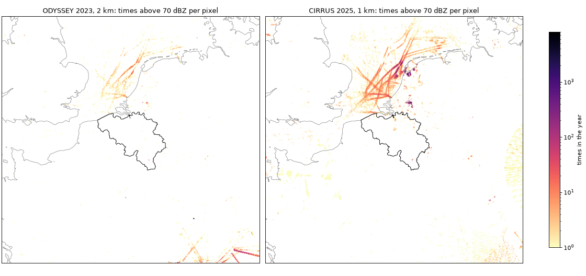

- **Fixed points.** In both products most values above 70 dBZ come from a few
  fixed points, which the persistent-point mask of H2 (`histo_cut`) should
  catch. In CIRRUS the darkest points are on and off the Dutch coast. What
  they are is not checked.
- **Lines over the North Sea**, from the Thames estuary and the Channel
  towards the Netherlands, in both products and stronger in CIRRUS. Their
  shape fits shipping lanes, which the RMI poster shows as lines in the
  Jabbeke accumulations (Delobbe and Goudenhoofdt 2014). This is sea clutter
  that reaches the composite, so it belongs to H2. It is an interpretation of
  the map, not checked against ship tracks.
- **Radial lines** in the south-east corner of ODYSSEY, and a radial pattern
  at the east edge of CIRRUS: these look like interference spikes, not
  checked.

### Catalogue: first run on ODYSSEY 2023 and CIRRUS 2025

`notebooks/05-mr-artefacts.ipynb`, section 4, run on the years on the PC
before the 2012–2024 crops. One pass per product and year gives, per pixel:
- the frequency of the reflectivity classes of Wagner et al. (2012, Table 1):
  7–19, 19–28, 28–37, 37–46, 46–55 and ≥ 55 dBZ;
- the annual sum of the Marshall–Palmer rate capped at 55 dBZ;
- the times above 70 dBZ.

`histo_cut` runs on the annual sum with the 5% tails of EURADCLIM.

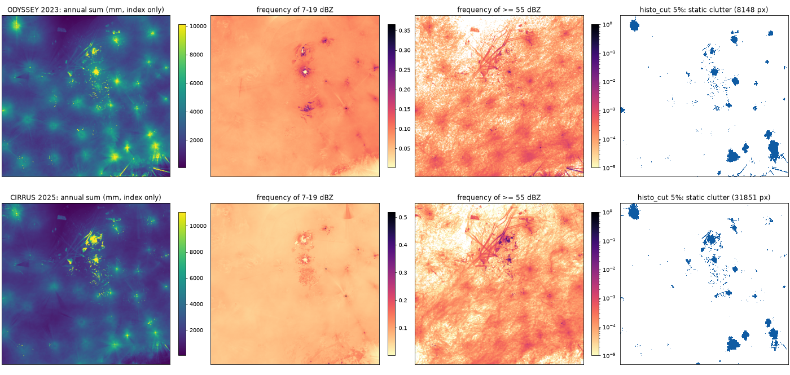

| product | files | annual sum, median (max) | `histo_cut` static clutter | shading |
|---|---:|---:|---:|---:|
| ODYSSEY 2023 | 34,408 | 2,831 mm (231,460 mm) | 8,148 px (3.4%) | 0 |
| CIRRUS 2025 | 103,791 | 2,204 mm (243,028 mm) | 31,851 px (3.3%) | 0 |

- **The annual sums are an index, not rain.** A column-maximum reflectivity
  converted with Marshall–Palmer gives sums far above the rain that falls in
  the region. They serve only as the statistic for `histo_cut`.
- **What `histo_cut` flags.** With 5% tails it flags mostly discs centred on
  the brightest spots of the annual sum, plus the patches on and off the Dutch
  coast. The discs may be the effect of distance from the radar on a maximum
  composite rather than clutter; this is not checked. So the 5% of EURADCLIM,
  set on a rain-rate composite, may be too wide for a maximum-reflectivity
  composite. This is a point for the first version.
- **What the frequency of ≥ 55 dBZ shows:** the lines over the North Sea in
  both products, and radial lines in the south-east of ODYSSEY.

### Catalogue: ODYSSEY 2013–2024

`notebooks/05-mr-artefacts.ipynb`, sections 4–5, on the 2012–2024 crops.
2012 is left out because only 576 of its frames can be read (`data.md`,
*Known problems*).

Under the real-time rule, the `histo_cut` mask of one year is applied to the
next year. So the mask must be stable from year to year.

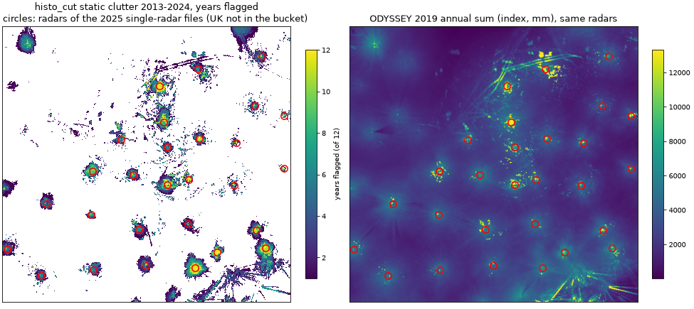

- **How much is flagged.** With 5% tails, `histo_cut` flags 6,042–12,172
  pixels a year as static clutter. It never flags shading.
- **The mask is not stable:**
  - 631 pixels are flagged in all 12 years, and 1,949 in 10 or more;
  - 15,748 pixels are flagged in only 1 to 3 years;
  - of each year's mask, 59–83% was already flagged the year before.
- **What the stable pixels are:** the centres of the discs and the fixed
  points. The outer rings of the discs change from year to year, as rain
  would.
- **The discs sit on the radars** (review of #74). The positions of all the
  radars of `how/nodes` come from the OPERA radar database (`data.md`,
  *Radars in the ODYSSEY composites*). The database adds the UK radars and the
  stopped ones that are missing from the 2025 single-radar files.
  - Of the 44 discs flagged in at least 6 years (at least 20 pixels each), 29
    have their centre within 10 km of a radar and 31 within 20 km.
  - Of the pixels flagged in at least 10 years, 80% lie within 20 km of a
    radar, against 5.5% of the crop.
  - So these discs are the excess of a maximum composite near each radar,
    where the beam is low, and not clutter. With 5% tails, `histo_cut` on the
    annual sum removes rain there.
  - For the first version, the static mask is to be based on the frequency
    maps (Wagner et al. 2012) and on the points above 70 dBZ instead.
- **Discs with no radar** (white squares). 13 discs have their centre more
  than 20 km from any radar of the database, so they come from another
  source: a wind farm, a transmitter or strong clutter. These are the ones
  the static mask must catch.
  - **At sea or on the coast:**
    - north of the Wadden islands, at 54.0 N, 6.5 E and 54.0 N, 6.9 E;
    - off North Holland, at 53.1 N, 4.3 E;
    - off the Belgian coast, at 51.6 N, 2.9 E.
  - **Inland, Netherlands:** 53.0 N, 5.4 E and 52.3 N, 4.9 E.
  - **Ardennes and Luxembourg:** 50.2 N, 5.7 E; 50.0 N, 6.1 E; 49.8 N, 5.1 E.
  - **Alps:** 47.5 N, 10.3 E; 46.7 N, 7.8 E; 46.8 N, 10.4 E; 46.4 N, 9.3 E.
  - What each one is was not checked. Wind-farm positions (*Choice*,
    later improvements) would check the ones at sea and in the Netherlands
    and the Ardennes. The Alpine ones are consistent with mountain clutter.
- **Bug in wradlib 2.9.8.** `histo_cut` fails when its input has NaN: it
  starts from `max()`, not `nanmax()`. In 2013 there are 337 crop pixels that
  are never covered. The notebook therefore passes only the pixels with at
  least one valid time.

### Radars over time: monthly catalogue, ODYSSEY 2012–2024

`notebooks/05-mr-artefacts.ipynb`, section 7 (review of #74). Two sources are
used:
- the same per-pixel statistics as the catalogue, one month at a time (140
  months);
- the radars listed in `how/nodes` (`data.md`, *Radars in the ODYSSEY
  composites*).

For each radar of the OPERA database whose areas lie in the crop (45 radars),
two areas are compared month by month:
- *near*: a disc of 20 km around the radar;
- *far*: a ring at 60–100 km.

The quantity compared is the echo frequency, that is the share of valid
times with at least 7 dBZ. Rain changes from month to month in both areas,
so the near/far ratio follows the radar and its processing more than the
weather. Only months in which the radar is listed on at least 80% of the days
are used.

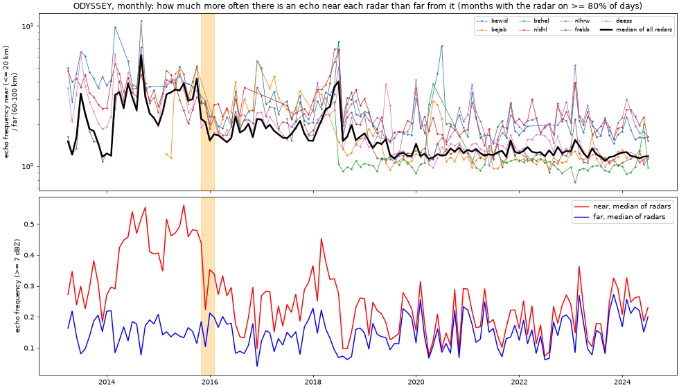

- **Two steps shared by almost all radars.**
  - **December 2015.** The median near-radar echo frequency over the radars
    falls from 0.42 in November 2015 to 0.22 in December 2015. The far one
    does not fall. Over 12 months before and after, the ratio falls by a
    factor of 0.57. The step matches the change of OPERA's central
    processing in December 2015: satellite filter and beam-blockage
    correction (Saltikoff et al. 2019).
  - **August 2018.** The near frequency falls again, from 0.23 in July to
    0.10 in August 2018. The OPERA note on CIRRUS and ODYSSEY (Radojevic
    2024, Table 3) says that ODYSSEY uses a 2018 satellite filter. A new
    version of the filter in 2018 is consistent with this step, but it is
    not proven: the note gives the year, not the month.
  - For each radar, the largest change of the ratio was taken (median of 6
    months after against 6 months before). For 25 of the 42 radars with
    enough months, it is a fall that starts in November 2015–April 2016 or in
    July 2018–August 2019.
  - All 21 falls stronger than a factor of 0.6 start in these two windows.
  - The UK and Swiss radars, at the edges of the crop, change less (falls
    of 0.76–0.87) or rise. Rises are also found in 2014 for `frabb`, `frtro`
    and `frtre`, and in January 2015 for `defld`.
- **Summer echoes near the radars until 2015.** In 2014 and 2015 the
  near-radar echo frequency reaches about 0.45 in summer, against 0.14–0.16
  far away. This summer excess almost disappears after December 2015. It
  fits echoes without rain near the radars that the satellite filter
  removes. It is the example of this artefact type for the catalogue.
- **Since 2019 the near/far ratio is about 1.2 all year** (median of the
  radars, summer and winter). In 2014–2018 it was 1.4–3.1, with 2.8–3.1 in
  the summers of 2014, 2015 and 2018.
  So the near-radar discs of the yearly catalogue belong mostly to
  2013–2018.
- **Consequence.** ODYSSEY is three products in a row: before December
  2015, from December 2015 to July 2018, and from August 2018. A mask or
  correction computed over one period does not apply to another. This
  supports a per-period catalogue, and the later satellite-mask option for
  the years before late 2015 (*Choice*).

### Catalogue: isolated echoes, blocked sectors, spokes

`notebooks/05-mr-artefacts.ipynb`, section 8. These complete the catalogue with
one example per artefact type.

**Isolated echoes, ODYSSEY 2023.**
- **Definition.** An echo pixel is isolated when its echo region has at most
  11 pixels (echoes above 0 dBZ, 8-connected). This is the size below which
  Gabella's shape test removes a region, as in section 1 of the notebook.
- **How common.** 1.2% of the echo pixel-times are isolated. The share is
  1.9% within 20 km of a radar, 1.5% at 20–60 km, and 0.9% beyond 60 km.
- **Where they lie:**
  - in rings and radial lines around the radars;
  - along the edge of a radar's coverage (an arc in the north-west);
  - rarely next to the two Dutch radars, where the centre stays empty.

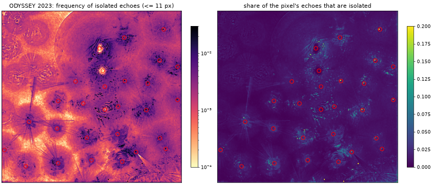

**Blocked sectors and spokes.** These follow the azimuth test of Wagner et al.
(2012, section 3).
- **Data.** The echo frequency (≥ 7 dBZ) of the last period, September 2018 –
  June 2024. For each radar, the median of each 1° azimuth is taken in a ring
  at 20–80 km.
- **No blocked sector.** The profiles of the 39 radars on in that period
  show no wedge with fewer echoes and sharp edges. The azimuths below 90%
  of a radar's median form broad, smooth dips. The deepest is that of
  `chwei` (Weissfluhgipfel), whose frequency falls to about half over the
  eastern and southern azimuths, towards the inner Alps. This fits shielding
  by the terrain, but it cannot be told apart from the climate there.
- **Why.** The maximum composite fills a blocked sector of one radar with
  the echoes of its neighbours. OPERA has also corrected beam blockage
  centrally since late 2015 (Saltikoff et al. 2019). `histo_cut` found no
  shading either. So for blocked sectors the reason to leave them is written
  here.
- **Spoke residual.** On the 2023 annual sum, I counted the edges where two
  adjacent azimuths differ by more than 10% (Wagner's spoke-edge rule) over
  the 39 radars of the crop listed on at least half of the days of 2023. The
  numbers before and after cleaning are in *First version on ODYSSEY 2023
  (prototype)*. One year of rain also makes such edges, so the count after
  cleaning is an upper bound of the spokes left (interference included).

### Static mask: rules in the literature

For the static mask of the first version (*Choice*), our sources give these
rules on long series of echo frequency:
- **OPERA central quality control** (Scovell 2013; Saltikoff et al. 2019). A
  bin is rejected when its normalised monthly echo count exceeds a
  threshold: 60% as the network's first guess, 90% at the start. In a UK
  gauge trial the Peirce skill scores were 0.60 at 60% and 0.59 at 90%. It
  runs on single-radar data before compositing, and month by month.
- **RADVOL-QC TURBINE** (Ośródka et al. 2022). Echoes are accumulated over
  dry time steps for a few months, then a radar-specific threshold is
  applied, followed by editing by hand. No threshold values are given.
- **Wagner et al. (2012).** An area is drawn by hand around each clutter
  source, and the obvious pixels inside it are flagged by threshold. A 2 km
  buffer is added, and pixels inside the 95% interval of the frequency
  distribution are kept as clean. No threshold values are given.
- **EURADCLIM `histo_cut`.** Ruled out for our composite (*Catalogue: ODYSSEY
  2013–2024*).

I applied the OPERA rule (monthly echo frequency ≥ 7 dBZ above 60%) to the
monthly catalogue:

| period | months | pixels above 60% per month, median (max) | of them within 20 km of a radar | pixels above 90%, median |
|---|---:|---:|---:|---:|
| 4/2013–11/2015 | 32 | 2,040 (5,120) | 69% | 465 |
| 12/2015–7/2018 | 32 | 16 (3,327) | 70% | 0 |
| 8/2018–6/2024 | 72 | 0 (1,374) | 89% | 0 |

The rule finds almost nothing after 2015. So on our composite most of what
it targets was already removed upstream, and what it flags before December
2015 is mostly the near-radar excess.

**Rule of the first version** (proposed and agreed in the review of #74,
10/11/2026). Per period, a pixel is static clutter when either condition
holds:
- ≥ 55 dBZ in at least 1% of its valid times (the top class of Wagner et al.
  2012, above the 55 dBZ cap of Imhoff et al. 2020);
- \> 70 dBZ in at least 0.1% of its valid times (Fluck et al. 2021).

**The two thresholds, 1% and 0.1%, are ours.** They do not come from the
literature; they are set on our data:
- **Rain far from the radars.** More than 60 km from any radar, rain makes
  ≥ 55 dBZ in at most 0.12–0.22% of the times (99.9th percentile of those
  pixels in each period). 1% is 4.5 to 8 times higher.
- **Wolff's rule as published** (≥ 55 dBZ in ≥ 50% of the scans of a dry
  day) flags 1, 0 and 0 pixels in the three periods. OPERA already removes
  this kind of permanent clutter.
- **Fill rule.** A masked pixel is not set to no rain. Its value is
  replaced by the inverse-distance interpolation (power 2) of at most 4
  nearest clean neighbours, and only where that value is lower than the
  original (EURADCLIM, Overeem et al. 2023, section 3.3). EURADCLIM does
  this on hourly sums; the first version does it on each composite. The
  prototypes apply it in their before/after numbers.

| period | pixels flagged | ≥ 55 dBZ in ≥ 1% | > 70 dBZ in ≥ 0.1% | within 20 km of a radar | discs with no radar touched |
|---|---:|---:|---:|---:|---:|
| 4/2013–11/2015 | 763 | 560 | 221 | 58% | 6 of 13 |
| 12/2015–7/2018 | 664 | 631 | 78 | 72% | 5 of 13 |
| 8/2018–6/2024 | 231 | 205 | 109 | 52% | 5 of 13 |

- **Near the radars.** The pixels close to the radars are close-range ground
  clutter at high reflectivity. They are not the weak-echo excess that makes
  the discs.
- **Discs with no radar.** The rule touches only 5 or 6 of the 13. Their
  echoes are frequent but weaker, which points to wind farms. A second rule
  (a pixel far above its neighbours in a frequency map, as Wagner et al. 2012
  do by hand) or the wind-farm positions of *Choice* would catch them. Both
  are left for after the first version.
- **Per radar** (review of #74). Each masked pixel is attached to the
  nearest radar of `how/nodes` within 20 km, and is on only when that radar
  is listed. The other masked pixels stay on, including those of the discs
  with no radar.
  - The 20 km are ours, like the 1% and the 0.1%: 31 of the 44 discs of
    *Catalogue: ODYSSEY 2013–2024* are centred within 20 km of a radar.

### Cleaning code (`opera_ds/clean.py`)

The first version is coded in `opera_ds/clean.py`, as the prototypes of notebook 05 describe it, with Gabella as a switch (review of #74):
- `clean_composite(dbz, static, listed, gabella=True)`:
  1. > 70 dBZ to no rain;
  2. Gabella, when `gabella` is true;
  3. the static mask, with the radars `listed` in `how/nodes` for that time.
- `StaticCounts`: per-pixel counts on past composites (valid times, ≥ 55 dBZ, > 70 dBZ) and the mask rule.
- `StaticMask`: the fill tables and the radar each masked pixel belongs to (within 20 km).
- `static_fill`: the EURADCLIM fill.
- `odyssey_period`: the three periods of ODYSSEY.

`tests/test_clean.py` checks the steps on synthetic fields:
- an impossible value is removed;
- the Gabella switch removes an isolated spike only when on;
- the coverage is kept;
- the mask rule flags the right pixels;
- the fill only lowers;
- a masked pixel is switched with its radar;
- in the full chain, the core of a smooth rain cell is kept.

On ODYSSEY 2023, with the mask of 8/2018–12/2022, the code gives the shares of the prototype:
- with Gabella: 5.60% of the rain index removed, 8.12% of the convective part, 1.39% of the stratiform part (prototype 1.38%);
- without Gabella: 0.73%, 1.14% and 0.03%.

### First version on ODYSSEY 2023 (prototype)

`notebooks/05-mr-artefacts.ipynb`, section 9. This is an exploration of the
*Priority* above, before the code in `opera_ds`. Each 15 min composite of
2023 goes through three steps, in this order:

1. **Impossible values:** echoes above 70 dBZ are set to no rain.
2. **Gabella:** the cells it flags are set to no rain, as in EURADCLIM.
3. **Static mask:** the proposal of *Static mask: rules in the literature*,
   computed on 8/2018–12/2022. That is the third period, before 2023, as the
   real-time rule requires.
   - It has 250 pixels, 25 of them in Belgium.
   - Each pixel belongs to its nearest radar within 20 km, and is on only on
     the days that radar is listed in `how/nodes`.
   - The rain of a masked cell is replaced by the inverse-distance mean of its
     4 nearest unmasked cells, but only when that mean is lower. EURADCLIM
     does this on hourly sums; here it is done on each composite.

Settings:
- **Rain:** Marshall–Palmer, capped at 55 dBZ, from 7 dBZ (Imhoff et al.
  2020).
- **Classes:** Steiner on the original field at 2 km.
- **Belgium:** cells at least half inside the Natural Earth mask.

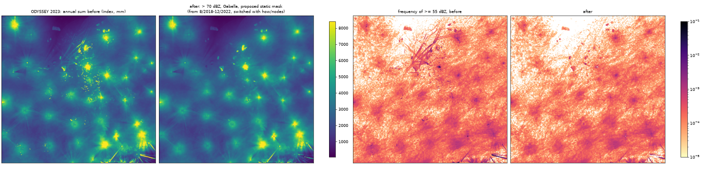

Every before/after is given with and without Gabella (review of #74).

| Gabella | pixels | > 70 dBZ | Gabella | static mask | total |
|---|---|---:|---:|---:|---:|
| with | all | 0.16% | 5.12% | 0.32% | 5.60% |
| with | convective | 0.25% | 7.36% | 0.51% | 8.12% |
| with | stratiform | 0.00% | 1.37% | 0.02% | 1.38% |
| without | all | 0.16% | — | 0.57% | 0.73% |
| without | convective | 0.25% | — | 0.89% | 1.14% |
| without | stratiform | 0.00% | — | 0.03% | 0.03% |

The table gives the share of the 2023 rain, as an index, that each step
removes. Without Gabella the static mask removes more (0.57% against 0.32%),
because with Gabella part of the same pixels is already gone.

| | with Gabella | without Gabella |
|---|---:|---:|
| Belgium, annual sum removed | 8.4% | 0.5% |
| pixels with ≥ 55 dBZ in > 1% of the times (166 before) | 2 | 30 |
| pixels with ≥ 55 dBZ in > 0.1% of the times (1,984 before) | 577 | 1,730 |
| spoke edges (1,839 before) | 1,629 | 1,836 |

- **Belgium, with Gabella.** 8.4% of the annual sum is removed: from 3,765
  to 3,447 mm, as an index.
- **Which echoes are kept (with Gabella):**
  - above 70 dBZ, 0.2% are kept; the 101 left are exactly 70.0 dBZ;
  - 55–70 dBZ: 72% kept;
  - 40–55 dBZ: 94% kept;
  - 20–40 dBZ: 98% kept;
  - 0–20 dBZ: 94% kept.
- **Strong echoes that repeat** (≥ 55 dBZ):
  - pixels with them in more than 0.1% of the times: from 1,984 to 577;
  - pixels with them in more than 1% of the times: from 166 to 2;
  - the North Sea lines and most fixed points go;
  - part of the radial lines in the south-east stays.
- **No holes around the radars.** The annual sum after cleaning keeps the
  discs: they are the near-radar excess, a matter of harmonisation with
  CIRRUS, not of cleaning.
- **What stays:**
  - some of the discs with no radar, as expected (*Static mask: rules in the
    literature*);
  - the radial lines.
- **Spoke residual** (39 radars, as in *Catalogue: isolated echoes, blocked
  sectors, spokes*): 1,839 edges before, 1,632 after Gabella and 1,629 after
  the static mask; 1,836 without Gabella. Gabella removes 11% of the edges;
  the static mask almost none.
- **Without Gabella** the first version removes only the values above 70 dBZ
  and the masked fixed points. Most of the North Sea lines stay: 30 pixels
  remain with ≥ 55 dBZ in more than 1% of the times. The choice between the
  two is made later, against a reference (RADCLIM or VMM, H5; *Choice*).
- **Gabella and real rain.** Over the year, Gabella removes 7.36% of the
  convective rain. That is more than the 4.9% on the five summer days of
  *Gabella filter at 2 km and 1 km*, because here the share also includes the
  fixed points that Steiner classes as convective. This number is to be read
  together with the trimming of real cells noted there.
- **The same on the two earlier periods** (section 9). One year of each
  period is cleaned with a mask computed on the months of that period
  before the year, as the real-time rule requires:
  - 2015 uses a mask from 4/2013–12/2014 (490 pixels);
  - 2017 uses a mask from 12/2015–12/2016 (782 pixels).

  | year | Gabella | > 70 dBZ | Gabella | static mask | total (index) | Belgium | median pixel | pixels ≥ 55 dBZ in > 1% |
  |---|---|---:|---:|---:|---:|---:|---:|---:|
  | 2015 | with | 0.22% | 24.11% | 2.36% | 26.69% | 25.1% | 5.0% | 543 → 22 |
  | 2015 | without | 0.22% | — | 11.21% | 11.43% | 4.2% | 0.1% | 543 → 191 |
  | 2017 | with | 0.46% | 15.30% | 1.83% | 17.59% | 26.2% | 4.4% | 516 → 18 |
  | 2017 | without | 0.46% | — | 6.43% | 6.89% | 11.4% | 0.3% | 516 → 143 |
  | 2023 | with | 0.16% | 5.12% | 0.32% | 5.60% | 8.4% | 3.4% | 166 → 2 |
  | 2023 | without | 0.16% | — | 0.57% | 0.73% | 0.5% | 0.0% | 166 → 30 |

  - **Earlier periods need more cleaning.** In 2015 and 2017 the total
    removed is 3 to 5 times that of 2023, with and without Gabella. This
    matches the three products of *Radars over time*.
  - **The total is dominated by a few pixels.** The median pixel loses only
    3–5% of its annual sum with Gabella, and 0.0–0.3% without. So most of
    what is removed comes from a few strong fixed points: in 2015 and 2017
    there are over 500 pixels with ≥ 55 dBZ in more than 1% of the times.
    So the large shares of 2015 and 2017 do not mean that a quarter of the
    rain is lost; how much real rain is lost is to be measured against a
    reference (H5).
  - **Without Gabella, the static mask leaves many fixed points:** 191 such
    pixels in 2015 and 143 in 2017. With Gabella, 22 and 18 are left.
- **The earlier prototype with `histo_cut` of 2022** (section 6, ruled out)
  removed 9.15% of the rain (12.86% of the convective rain). It left dark
  rings and holes around several radars, where real strong echoes of 2023
  were lowered together with the clutter.

### First version on CIRRUS, July–December 2024 (prototype)

`notebooks/05-mr-artefacts.ipynb`, section 10 (review of #74). These are the
same steps as on ODYSSEY, with the static mask computed on CIRRUS itself, as
the operational chain would do. CIRRUS starts on 1/7/2024, so here the mask
comes from the same six months: the test is in-sample. Applied to later
months, as the real-time rule requires, it would be out of sample.

- **Data.** 48,939 crops at 1 km and 5 min. The radars come from `how/nodes`
  of the CIRRUS crops, placed with the OPERA radar database. Steiner classes
  are computed on the 2 km grid, as in section 1.
- **Mask.** 1,453 pixels at 1 km, 269 of them in Belgium.
  - 1,439 pixels have ≥ 55 dBZ in at least 1% of the times, and 254 have
    > 70 dBZ in at least 0.1%.
  - 43% of the mask pixels lie within 20 km of a radar.
  - Far from the radars, rain makes ≥ 55 dBZ in at most 0.20% of the times
    (99.9th percentile), as on ODYSSEY. So the threshold of 1% transfers
    to CIRRUS.

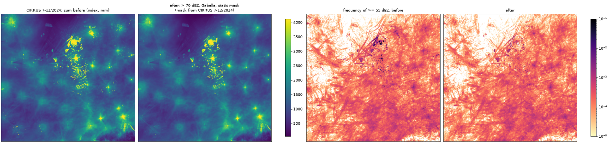

| Gabella | pixels | > 70 dBZ | Gabella | static mask | total (index) |
|---|---|---:|---:|---:|---:|
| with | all | 0.06% | 3.24% | 2.49% | 5.80% |
| with | convective | 0.10% | 4.43% | 3.80% | 8.33% |
| with | stratiform | 0.00% | 1.00% | 0.02% | 1.02% |
| without | all | 0.06% | — | 3.21% | 3.27% |
| without | convective | 0.10% | — | 4.89% | 4.99% |
| without | stratiform | 0.00% | — | 0.03% | 0.03% |

| | with Gabella | without Gabella |
|---|---:|---:|
| Belgium, sum removed | 13.9% | 7.2% |
| median pixel, sum removed | 0.9% | 0.0% |
| pixels with ≥ 55 dBZ in > 1% of the times (1,439 before) | 0 | 0 |
| pixels with ≥ 55 dBZ in > 0.1% of the times (11,614 before) | 5,822 | 9,959 |
| echoes of 55–70 dBZ kept | 71% | 78% |
| echoes of 40–55 dBZ kept | 93% | 96% |

- **Gabella removes less on CIRRUS than on ODYSSEY:** 3.2% against 5.1% in
  2023. This fits the smaller loss at 1 km in *Gabella filter at 2 km and
  1 km*.
- **The static mask matters more on CIRRUS.** It removes 2.5–3.2% of the
  index, against 0.3–0.6% on ODYSSEY 2023. Belgium has 269 mask pixels at
  1 km; where exactly they lie was not mapped.
- **What stays:**
  - large bright patches in the Netherlands and near the Belgian coast, with
    frequent echoes below 55 dBZ;
  - part of the North Sea lines.

  These match the discs with no radar of *Catalogue: ODYSSEY 2013–2024*:
  the second rule or the wind-farm option would be needed for them.
- **In-sample.** The fact that no pixel stays above 1% at ≥ 55 dBZ is
  expected, because the mask was built on the same months.

### CIRRUS 2025, out of sample

`notebooks/05-mr-artefacts.ipynb`, section 11 (review of #74). The mask of 7–12/2024 is applied to all of 2025, as
the operational chain would apply a mask from past composites only. The radars come from `how/nodes` of the
2025 crops. 103,791 composites.

| share of the index removed | > 70 dBZ | Gabella | static mask | total | in-sample 7–12/2024 |
|---|---:|---:|---:|---:|---:|
| with Gabella | 0.17% | 3.15% | 2.40% | 5.72% | 5.80% |
| without Gabella | 0.17% | — | 3.00% | 3.17% | 3.27% |

- **The in-sample numbers hold out of sample.**
- **Repeated strong echoes** (pixels with ≥ 55 dBZ in more than 1% of the times):
  - from 1,406 to 132 with Gabella;
  - from 1,406 to 297 without Gabella.

  Some fixed points of 2025 were not in the mask of 2024.

**Where Belgium loses rain** (review of #74).

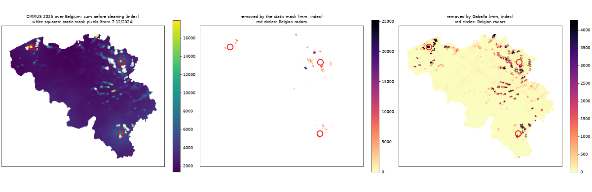

| | with Gabella | without Gabella |
|---|---:|---:|
| Belgium, sum removed | 8.2% (Gabella 6.4%, static mask 1.8%) | 3.3% (static mask) |
| the whole domain | 5.7% | 3.2% |
| median pixel | 1.1% | 0.1% |
| share of the Belgian loss within 20 km of a Belgian radar (11% of the area) | 47% | 69% |
| share of the Belgian loss on mask pixels | 46% | 100% |

- **Out of sample, Belgium loses 1.4 times the domain with Gabella and about the same without.** In-sample in
  2024 it lost 13.9% and 7.2%.
- **The losses are fixed points, not the near-radar excess:**
  - without Gabella, everything lost is on mask pixels, two thirds of it within 20 km of Jabbeke, Wideumont and
    Helchteren;
  - the mask pixels sit in compact patches around the radars and in a few isolated patches;
  - the weak-echo excess near the radars, which made the discs of *Catalogue: ODYSSEY 2013–2024*, is not
    touched: the mask needs ≥ 55 dBZ.
- **With Gabella, the rest of the Belgian loss** is spread over many small spots and short lines across the
  country, and is largest near Jabbeke and Helchteren.

### Sea clutter and anomalous propagation: literature

Leads given in the review of #74. The "DMI paper at ERAD" is Bøvith et al.
(2006); the link given with it (erad-312) is Peura (2002), already read.

| source | what it says | input |
|---|---|---|
| Delobbe and Goudenhoofdt 2014 (RMI poster) | raw Jabbeke reflectivity is strongly contaminated over the North Sea; offshore wind farms (one about 40 km offshore) and ship traffic give clutter even without anaprop; by 2014 a polarimetric fuzzy-logic filter (Selex Rainbow 5) was used operationally; its start date is not given (radar installed in 2012) | polarimetric single-radar data |
| Leijnse et al. 2016 (KNMI TR-355) | the older statistical filter removed only about 40% of sea clutter and the Doppler filter fails over waves; a speckle filter gave a large gain with little loss of rain; the satellite cloud mask was used to verify the filters | single-radar data; cloud mask for verification |
| Bøvith et al. 2006 (DMI, ERAD) | a classifier on a 1 km radar composite plus the NWC SAF precipitating-clouds product: 0.00% error in clear-sky anaprop sea clutter, 8.01% with rain nearby | composite + satellite product |
| wradlib notebook, `classify.filter_cloudtype` | a ready rule that flags echoes under cloud-free or non-precipitating cloud types | composite or polar + satellite cloud type |

On the composite, the literature points to the satellite mask (already
chosen) and a speckle filter. The polarimetric filters stay upstream, and
the comparison of `TH` with `DBZH` in the single-radar files asked in #74
measures what they leave.

### Gabella filter at 2 km and 1 km

`notebooks/05-mr-artefacts.ipynb`, sections 1–2. The filter was set on
single-radar 1 km maps (Gabella and Notarpietro 2002). On the 2 km grid its
5 × 5 window covers 10 km and the smallest kept echo is about 44 km², so it was
checked on rain, and on the January features it should remove (review of #74).

- **Data:** CIRRUS over the Belgian crop at the quarter hours: degraded to 2 km
  by `zmean` (the H1 stand-in for ODYSSEY), and at 1 km.
- **Filter:** wradlib defaults (5 × 5, 6 dB, `n_p` = 6, 1.3), `cartesian=True`,
  on dBZ with no echo at 0 dBZ.
- **Classes:** Steiner on the 2 km grid, as in H1.
- **Rain:** Marshall–Palmer capped at 55 dBZ, on echoes of at least 10 dBZ.
- **Summer days:** the 5 days of June–July 2025 with most Steiner convective
  pixels in H1: 7/6, 26/6, 6/7, 7/7 and 31/7.
- **January days:** the 5 days that carry 70% of the January `lk` deficit, with
  stationary features centred on radars: 5/1, 22/1, 24/1, 25/1 and 30/1.

| days | grid | convective rain removed (range per day) | stratiform rain removed |
|---|---|---:|---:|
| summer | 2 km | 4.9% (4.0–6.3%) | 0.9% |
| summer | 1 km | 2.3% (1.3–3.0%) | 0.6% |
| January, stationary features | 2 km | 11.2% (9.2–16.4%) | 0.4% |
| January, stationary features | 1 km | 7.1% (6.1–10.3%) | 0.4% |

- **Summer:** the echoes are rain, so what is removed is real rain lost.
- **January:** the filter removes more than twice the summer share at 2 km
  and three times at 1 km. The convective pixels of those days are mostly the
  stationary features, but not only them, so 11.2% is an upper bound of the
  gain on the features, not a measure of it.
- **Where the removed convective rain lies:** 92–93% inside echo regions,
  5–7% on edges and 1–3% in small echoes (at most 11 pixels, the size the
  area/perimeter test removes). So the filter acts mostly through its gradient
  test, on pixels much stronger than their neighbours, not by removing small
  cells.
- **For the first version** (review of #74): the filter mostly trims the
  peaks of real cells, which is the rain that matters for intense-rain
  thresholds (research question 3). This is reported next to the
  before/after numbers.

## Bridge data on the OPERA grid (S7)

The pan-European bridge candidates for the level correction (H3) are coarser
than OPERA: ERA5-Land about 9 km, CERRA-Land 5.5 km, against 2 km for ODYSSEY
([data.md](data.md), *Inventory of sources and licences*). Code in
`opera_ds/bridge.py`, first read in `notebooks/06-fc-bridge-data.ipynb`.

- **Coarse cells, never pixels.** Each OPERA pixel takes the bridge cell with
  the nearest centre, and OPERA is averaged over the pixels of each cell before
  any comparison. The bridge is not interpolated to pixels, because it holds no
  information at that scale. Over Belgium an ERA5-Land cell holds about 17
  pixels at 2 km and a CERRA-Land cell about 7.
- **Common window.** A CERRA-Land day runs from 06 UTC of the previous day to
  06 UTC, so every comparison with it sums ERA5-Land (hourly) and OPERA on the
  same 06–06 UTC days. ODYSSEY frames labelled 06:15 … 06:00 cover 06:05 →
  06:05 ([data.md](data.md), *Time windows*), 5 min later than the bridge.

### First read: July 2013

ODYSSEY with the first-version cleaning (static mask counted on the same month,
always in use), Marshall-Palmer from 7 dBZ capped at 55 dBZ; 2,969 of 2,976
frames; Belgian cells of each grid.

| bridge | cells | bridge median | ODYSSEY median on the same cells | ratio of medians | Spearman, cell by cell |
|---|---:|---:|---:|---:|---:|
| ERA5-Land | 446 | 45.3 mm | 152.4 mm | 3.36 | 0.54 |
| CERRA-Land | 1,087 | 56.9 mm | 151.7 mm | 2.67 | −0.26 |

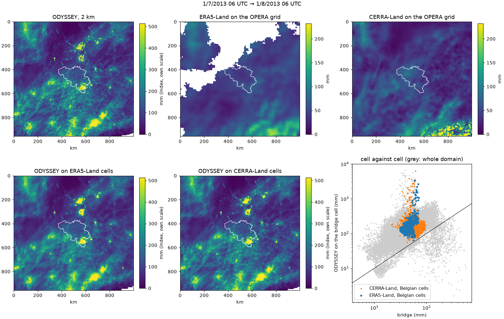

- The ODYSSEY level is about three times the bridges. This agrees with the
  sums of a maximum-reflectivity composite being an index rather than rain
  (*Catalogue: first run on ODYSSEY 2023 and CIRRUS 2025*); it is one month,
  before the H3 correction.
- The bright ODYSSEY spots around the radars and in the south-east of Belgium
  survive a static mask counted on one month, and they dominate the cell
  means. Over Belgium ODYSSEY ranks the cells like ERA5-Land but not like
  CERRA-Land; whether this comes from those spots or from CERRA-Land is not
  checked.

## Level correction (H3)

Work in progress (#20). ODYSSEY has about half the rain volume of CIRRUS over
Belgium on the 4 overlap days, a gap of 3.5–5 dB at all quantiles
([data.md](data.md), *Known problems*). This section will compare three ways to
remove that gap with the same criteria: a pan-European bridge, a national
bridge, and plain seasonal quantile mapping.

### Bridge candidates: coverage and known biases

A bridge must cover both sides of the change: ODYSSEY until 7/2024 and CIRRUS
from 7/2024 (`data/cirrus_bel/` reaches 10/2026). It must also be independent of
the OPERA processing, otherwise it carries the same jump. Periods and products
are those of [data.md](data.md), *Inventory of sources and licences*, and of S7
(#77) for the pan-European sources.

| bridge | quantity and resolution | period | both sides of 7/2024 | independent of OPERA |
|---|---|---|---|---|
| ERA5-Land | hourly, 0.1° grid; the precipitation is ERA5's (about 31 km), linearly interpolated with no correction | 1950 → now | yes | yes |
| CERRA-Land | daily, 06–06 UTC, 5.5 km; CERRA forecast corrected with daily gauges | 1984 → 12/2025 | yes, 18 months after the change | yes |
| EMO-1 | daily and 6-hourly gauge interpolation, about 1.8 km | v3.0.0 to 2023; 2024 only in a preprint | not yet | yes |
| EURADCLIM 3.0 (4 announced) | 1 h and 24 h, 2 km, OPERA adjusted with gauges | 2013–2023 (2024 announced) | no | no: built on the OPERA composites |
| RADCLIM, project's copy (kriging with external drift) and MLCast version (mean-field bias) | 5 min, 1 km, radar merged with gauges | 1/2017 → 11/2023 | no | yes |
| VMM | 5 min intensity, radar only, 1 km CAPPI; 15 min, 1 h and 24 h sums adjusted with VMM gauges | API: last six months only; project's copy: scattered in 2021–2022, almost continuous from 2023 | yes, from 2023 | partly: own compositing, but Jabbeke and Helchteren are also OPERA radars |

What the literature says about the two pan-European candidates:

- **ERA5-Land does not add resolution to precipitation.** The field is ERA5's,
  interpolated from about 31 km to 9 km; only temperature, humidity and
  pressure get a height correction
  ([Muñoz-Sabater et al. 2021](sources/2021%20-%20Muñoz-Sabater%20-%20ERA5-Land%20a%20state-of-the-art%20global%20reanalysis%20dataset%20for%20land%20applications.md),
  section 2). The paper does not evaluate precipitation.
- **ERA5 and ERA5-Land rain too often and too little at the top.** Over Swiss
  catchments, 1986–2020: about 45 wet days (≥ 1 mm) too many per year, the
  wettest day of the year about 22% too low and daily variability about 20% too
  low; CERRA-Land is close to the gauges on all three
  ([Wood et al. 2025](sources/2025%20-%20Wood%20-%20Comparison%20of%20high-resolution%20climate%20reanalysis%20datasets%20for%20hydro-climatic%20impact%20studies.md),
  Figs. 3 and 5, values read from the figures). Against 5,637 gauges in
  2001–2020, ERA5 is wetter than the gauges by 0.14–0.26 mm/day, mostly from
  rain on days that are dry at the gauge. In the extratropics its mean annual
  maximum is 36.5 mm/day against 52.3 at the gauges, and in Europe its skill
  is highest in winter and drops in summer
  ([Lavers et al. 2022](sources/2022%20-%20Lavers%20-%20An%20evaluation%20of%20ERA5%20precipitation%20for%20climate%20monitoring.md),
  section 3, Figs. 2, 6–8). This is why the wet frequency has to be matched
  before the quantiles
  ([Themeßl et al. 2012](sources/2012%20-%20Themeßl%20-%20Empirical-statistical%20downscaling%20and%20error%20correction%20of%20regional%20climate%20models%20and%20its%20impact%20on%20the%20climate%20change%20signal.md),
  section 2.2.2). For radar, the same order is the probability matching
  method: first the reflectivity whose exceedance frequency equals the
  reference wet fraction, then the distributions above it, matched rank by
  rank and with no time pairing
  ([Rosenfeld et al. 1993](sources/1993%20-%20Rosenfeld%20-%20General%20probability-matched%20relations%20between%20radar%20reflectivity%20and%20rain%20rate.md),
  section 5a, Eqs. 4–5).
- **CERRA-Land depends on its gauge network.** A changing number of stations
  can create spurious trends (Wood et al. 2025, section 7). The part after
  6/2021 comes from a new production contract, and its homogeneity with the
  earlier part is not documented (S7, #77).
- **Neither paper evaluates hourly precipitation or the diurnal cycle.**

### Homogeneity of the bridge

A bridge links ODYSSEY and CIRRUS only if it has no break of its own near
7/2024 (#20, *In scope*, decided 11/11/2026). A change over time counts as
climate only with a published source. This section collects what the
literature says; the test in the data waits for the ERA5-Land files of S7 and
the project's VMM copy.

**ERA5-Land.** Its precipitation is ERA5's, only interpolated
([Muñoz-Sabater et al. 2021](sources/2021%20-%20Muñoz-Sabater%20-%20ERA5-Land%20a%20state-of-the-art%20global%20reanalysis%20dataset%20for%20land%20applications.md),
section 2.3), so its homogeneity is ERA5's.

- **Fixed system, changing inputs.** ERA5 keeps one model and assimilation
  system (IFS Cy41r2) but ingests every available observation, so the amount
  of data changes over time and "modulates the biases"; no rain gauge is
  assimilated, and radar rain rates only over the United States
  ([Soci et al. 2024](sources/2024%20-%20Soci%20-%20The%20ERA5%20global%20reanalysis%20from%201940%20to%202022.md),
  section 1, p. 4015). Over Europe rain enters only through all-sky
  microwave radiances, from at most three imagers at a time; AMSR2 starts in
  2012 and GMI replaces TMI in 2015, and the record of dated inputs ends about
  2019
  ([Hersbach et al. 2020](sources/2020%20-%20Hersbach%20-%20The%20ERA5%20global%20reanalysis.md),
  section 5, p. 2018, Table 4). No source dates the inputs of 2020–2026.
- **Production seams.** ERA5 is spliced from parallel production runs, and a
  jump can occur at each joint. Joints in 2012–2026: 1/1/2015, 1/3/2019,
  1/9/2021, 1/1/2022 and 23/10/2022; the last run is still going, so there is
  none in 2023–2026
  ([ECMWF documentation](sources/2026%20-%20ECMWF%20-%20ERA5%20data%20documentation%20and%20known%20issues.md),
  *Production experiments*, read 11/11/2026). At the 2015 joint soil moisture
  jumps; the effect on precipitation is not shown (Soci et al. 2024, p. 4028).
- **Events near the switch.** The final ERA5 was rerun from 7/2024 for wrong
  snow observations in the Alps; it differs from the preliminary version from
  1/7 to 17/11/2024, mainly in snow and 2 m temperature, and ECMWF states that
  ERA5-Land is not affected. Sea-surface temperature was frozen on
  24–29/6/2024 and sea ice on 11–18/9/2024; no effect on precipitation is
  documented (ECMWF documentation, *Known issues*). The last 2–3 months of a
  download are preliminary data, so they are downloaded again before a fit.
- **Slow drift.** Against homogenised gauge grids, ERA5 annual precipitation
  drifts by +1.4 % (Italy) and +1.6 % (Alps) per 10 years over 1940–2010, and
  rises again from 1995 to 2020; it is a drift, not a step
  ([Lussana et al. 2024](sources/2024%20-%20Lussana%20-%20Evaluating%20long-term%20trends%20in%20annual%20precipitation%20A%20temporal%20consistency%20analysis%20of%20ERA5%20data%20in%20the%20Alps%20and%20Italy.md),
  Tables 1–2, section 4). At that rate it would be about 2 % over 2012–2026
  (computed here); comparing months close to 7/2024 limits it.

**VMM.** The radar-only intensity `SRI_1km_cappi` is a composite of Helchteren
(VMM, since 23/10/2016) and Jabbeke (RMI, since 2012), with Herwijnen (KNMI)
in the 02/2022 service manual but not in a parliamentary answer of the same
year ([radar network changes](sources/2026%20-%20RMI%20and%20VMM%20-%20Belgian%20radar%20network%20changes%202016–2026.md)).

- **No documented change in 7/2024.** No public source gives a hardware,
  calibration or processing change of these radars or of the VMM composite in
  2023–2026, nor the Z–R relation or clutter filter of `SRI_1km_cappi` in any
  year. Absence of records is not evidence of homogeneity: Helchteren is
  serviced twice a year
  ([Grosemans 2022](sources/2022%20-%20Grosemans%20-%20Overstromingen%20juli%202021%20Limburg%20-%20Netwerk%20pluviometers%20-%20Dossiers.md)).
- **Jabbeke, September 2024.** VMM serves `*_BEJAB0924issue` series from
  1/10/2024 ([data.md](data.md), VMM row), and KNMI changed the Jabbeke scans
  it ingests on 9/9/2024
  ([Overeem et al. 2025](sources/2025%20-%20Overeem%20-%20The%20Dutch%20real-time%20gauge-adjusted%20radar%20precipitation%20product.md),
  section 7.2). Neither source says what changed. The date is two months after
  the ODYSSEY → CIRRUS switch, so a VMM comparison is tested at both 7/2024 and
  9/2024.

**Climate around the switch.** At Uccle, 2024 was the wettest year since 1833
(1,170.7 mm) and 2025 the driest since 1991 (620.6 mm), against a 1991–2020
normal of 837.3 mm; every month from 10/2023 to 9/2024 was wetter than normal,
and 2025 was drier than normal everywhere in Belgium
([RMI overviews](sources/2026%20-%20RMI%20-%20Climatological%20overviews%20of%20Belgium%202012–2026.md),
overviews 2024 and 2025). On the overlap days the rain was small: of the
87.0 mm of 1–12/7/2024, 78.8 mm fell on 9 and 12 July (monthly overview
2024-07). No published trend reaches 2024: at Uccle, 1981–2019, annual and
summer totals have no significant trend, spring falls by about 9 mm per decade
and the 1 h maximum rises by about 3 mm per decade
([RMI 2020](sources/2020%20-%20RMI%20-%20Klimaatrapport%202020.%20Van%20klimaatinformatie%20tot%20klimaatdiensten.md),
pp. 13–15).

- **Consequence.** A drop of the absolute level from 2024 to 2025 is expected
  from the weather. A step in the ratio between a radar product and the bridge
  is not: the weather is in both. The same months are therefore compared on
  both sides, and a wet ODYSSEY year (2021, 2023) is set against the wet 2024.

**Test in the data (to run when the files are here).** ERA5-Land and VMM,
monthly on the Belgian ERA5-Land cells, from 2023, as the ratio of the two
sums; a break is looked for at 7/2024 and 9/2024, with the days of the ERA5
events above left out. VMM pixels (500 m) take the ERA5-Land cell with the
nearest centre and are averaged over it (`opera_ds/bridge.py`,
`opera_ds/vmm.py`); `opera_ds/homog.py` gives the monthly ratio and its step
at a date, in log10, beside the month-to-month spread before it. The test
statistic and its threshold are still to be chosen from the homogenisation
literature. The ERA5-Land / CERRA-Land
comparison over 2012–2025 is in H3b (#82).

### ODYSSEY and CIRRUS alone: the gap and the year-to-year spread

`notebooks/07-mr-level-correction.ipynb`: distributions of reflectivity over Belgium (Natural Earth mask) per
month and hour of day, ODYSSEY at 2 km and CIRRUS degraded to 2 km by `zmean` (H1), with no cleaning other than
the split at 70 dBZ (#20 starts with the cap only).

**Overlap days.** On the 382 paired times of 1–5/7/2024 (ODYSSEY at NT, CIRRUS at NT+5, cells covered by
both):

| | share of pixels with echoes ≥ 10 dBZ | q10 | q25 | q50 | q75 | q90 | q99 |
|---|---:|---:|---:|---:|---:|---:|---:|
| ODYSSEY, all echoes [dBZ] | 15.6% | −3.75 | 2.75 | 10.75 | 21.75 | 31.25 | 41.75 |
| CIRRUS 2 km, all echoes [dBZ] | 22.6% | −2.75 | 4.75 | 14.75 | 25.25 | 33.75 | 46.75 |
| CIRRUS − ODYSSEY, all echoes [dB] | | 1.0 | 2.0 | 4.0 | 3.5 | 2.5 | 5.0 |
| CIRRUS − ODYSSEY, echoes ≥ 10 dBZ [dB] | | 0.5 | 1.5 | 1.0 | 1.0 | 1.5 | 5.5 |

- Most of the gap is in **how often** ODYSSEY has an echo, not in how strong: among echoes of at least 10 dBZ
  the shift is 0.5–1.5 dB up to the 90th percentile, close to the 1.30 dB median offset of the `zmean`
  degradation over Belgium (*Degraded CIRRUS as a stand-in for ODYSSEY*). It is 5.5 dB only at the 99th
  percentile.
- `data.md`, *Known problems*, gives "3.5–5 dB at all quantiles" for the same days. On all echoes the shift
  here is 1–5 dB, and on echoes of at least 10 dBZ it is smaller. The two numbers do not come from the same
  selection of pixels; which one #20 should start from is open.

**Calendar months.** ODYSSEY 8/2018–6/2024 (its last period, *Radars over time*) against CIRRUS 8/2024–11/2026
on the ODYSSEY times, July 2024 left out:

- Each month changes much more from year to year than the products differ on the overlap days. In June, the
  ODYSSEY share of pixels with echoes ≥ 10 dBZ goes from 7.5% (2023) to 25% (2020), and its median echo from 7
  to 15 dBZ.
- The CIRRUS months fall inside the ODYSSEY spread, often at its low end; spring 2025 and July 2026 are dry.
- July 2026 has echoes on 5% of the Belgian pixel-times, against 17–26% in the other summer months, while the
  Belgian radars are listed in `how/nodes`. Not checked against gauges.

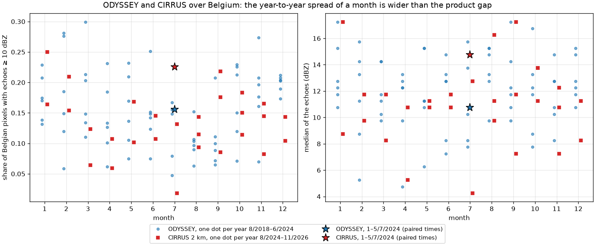

**Consequence for the plain seasonal quantile mapping.** With two years of CIRRUS, a mapping fitted month by
month between the products would carry the weather of 2024–2026 into the ODYSSEY years instead of the product
difference. A bridge is needed to separate the two (#20, *Goal*). The plain mapping stays as the reference that
the bridges must beat on the overlap days.

### Radar rain on the ERA5-Land grid

Ready for the pan-European bridge: hourly radar rain over Belgium on the ERA5-Land grid of `fetch_cds.py`
(0.1°), for all ODYSSEY and CIRRUS months (`notebooks/07-mr-level-correction.ipynb`, section 4;
`results/h3_level/era5grid_*.npz`).

- **Rain rate:** Marshall–Palmer from 7 dBZ, capped at 55 dBZ, with no rain above 70 dBZ.
- **Hours:** each frame stands for the step that ends at its label, so the hour ending at H sums 12 CIRRUS or
  4 ODYSSEY frames, as the ERA5-Land hourly amounts end at their time stamp.
- **Index, not ground rain:** with no cleaning, the Belgian mean of July 2023 is about 370 mm. The bridge
  comparison therefore matches distributions, not amounts.

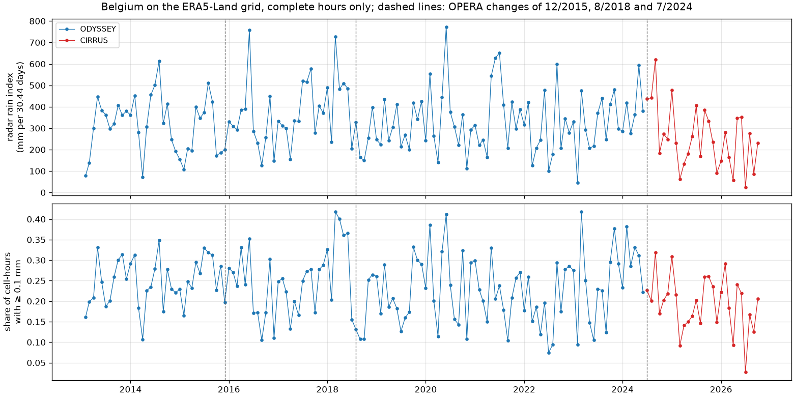

### Bridge mapping on synthetic data

`notebooks/07-mr-level-correction.ipynb`, section 5. Each ODYSSEY value goes to the bridge value with the
same cumulative probability over the ODYSSEY years, then to the CIRRUS value with the same cumulative
probability as that bridge value over the CIRRUS years. Dry stays dry: the wet frequency is set by the
threshold pair, as in the probability matching method (Rosenfeld et al. 1993, section 5a), and not by adding
rain at random as in frequency adaptation (Themeßl et al. 2012, section 2.2.2). This keeps the correction
deterministic.

The synthetic test uses one weather series per period for both the bridge and the product. ODYSSEY reads
half as strong as CIRRUS and misses weak rain. Scores are taken above the level that ODYSSEY still detects.

| weather of the CIRRUS years | share above that level: truth / plain / bridge | q50, q90, q99 over truth: plain | bridge |
|---|---|---|---|
| as the ODYSSEY years | 0.101 / 0.101 / 0.101 | 1.00, 1.01, 1.01 | 1.00, 1.00, 1.00 |
| drier | 0.100 / 0.047 / 0.100 | 0.81, 0.73, 0.70 | 1.00, 1.00, 1.00 |
| wetter | 0.101 / 0.101 / 0.101 | 1.74, 1.52, 1.44 | 1.00, 1.00, 1.00 |

- The plain mapping is right only when the two periods have the same weather. With a drier or a wetter
  CIRRUS period it is off by 30% to 74%.
- The bridge mapping recovers the truth in all three cases, provided the product-to-bridge relation is the
  same in both periods. That is the assumption the real bridges must satisfy.
- Rain that ODYSSEY never detects cannot be restored without inventing it. Below that level the corrected
  ODYSSEY stays drier than CIRRUS.

### Evaluation criteria, the same for the three variants

The two tests of #20, *In scope*, made concrete with measures the project already uses. Each variant is fitted
without the overlap days.

1. **Overlap days, 1–5/7/2024.** These are the 382 paired times over Belgium at 2 km: ODYSSEY at NT, corrected,
   and CIRRUS at NT+5, `zmean` (*ODYSSEY and CIRRUS alone*). The measures are:
   - the share of pixels at or above 10, 20 and 30 dBZ, the thresholds of *Validation against CIRRUS*;
   - the difference CIRRUS − corrected ODYSSEY at the 25th, 50th, 75th, 90th and 99th percentiles of all
     echoes and of echoes ≥ 10 dBZ.

   The same measures are taken on the hourly sums on the bridge grid, in mm.
2. **Continuity across 7/2024.** For each month, the ratio of the radar to the bridge is computed at the same
   percentiles of the wet cell-hours on the bridge grid. The jump is the mean ratio of the 12 CIRRUS months after
   7/2024 against the mean of the 12 ODYSSEY months before. It is compared with the spread of the same ratio
   from year to year within ODYSSEY 8/2018–6/2024, the last period. Proposed yardstick, ours, to be agreed at
   G1: a jump no larger than that spread.

The plain mapping is scored the same way. On the second test it has no bridge, so there it is scored only
on the overlap days.

### Plain seasonal quantile mapping on the overlap days

`notebooks/07-mr-level-correction.ipynb`, section 6. The fit maps ODYSSEY of the fitting months
(8/2018–6/2024, all pixels, dry included) onto CIRRUS of the same calendar months (2 km, ODYSSEY times). Dry
stays dry, and July 2024 is left out. The fit is applied to ODYSSEY on the 382 paired times:

| | share ≥ 10 / 20 / 30 dBZ | CIRRUS minus row at q25 / q50 / q75 / q90 / q99 [dB] |
|---|---|---|
| CIRRUS (target) | 0.226 / 0.134 / 0.058 | 0 |
| ODYSSEY, uncorrected | 0.156 / 0.084 / 0.036 | +2.0 / +4.0 / +3.5 / +2.5 / +5.0 |
| plain mapping, July, CIRRUS 2025 and 2026 | 0.090 / 0.048 / 0.021 | +4.0 / +5.5 / +4.5 / +3.0 / +5.5 |
| plain mapping, July, CIRRUS 2025 only | 0.174 / 0.097 / 0.044 | +0.5 / +2.0 / +1.5 / 0.0 / +3.0 |
| plain mapping, June–August, all CIRRUS | 0.131 / 0.065 / 0.026 | +1.0 / +3.5 / +4.5 / +3.5 / +6.0 |

- With all CIRRUS Julys, the plain mapping moves ODYSSEY **away** from CIRRUS. July 2026 is dry, so the
  mapping lowers ODYSSEY.
- With July 2025 alone it gets closer, but it is still lower than CIRRUS. The result depends on which CIRRUS
  year is in the fit, which is the year-to-year spread of *ODYSSEY and CIRRUS alone*.
- This is the baseline the bridges must beat.

## Training windows

### Sampling on ODYSSEY at 2 km

Same scheme as IRENE's `importance_sampler`, but on the ODYSSEY files at 2 km,
so that only the selected windows are interpolated. A window of T frames at
5 min needs ⌊(T−1)·5/15⌋ + 2 consecutive ODYSSEY frames (9 for T = 24): if one
is missing the window is discarded. It is also discarded if the fraction
outside coverage exceeds `max_nan_frac` (default 0.64%, as IRENE), and accepted
with probability q = min(1, q_min + m · mean(1 − e^(−R/s))).

The seed generates an independent generator per block (`SeedSequence.spawn`),
so results do not depend on how the period is split. (In the IRENE code, with a
fixed seed, every window would receive the same random number.)

### Window content

Windows are T × H × W (24 × 256 × 256 as IRENE) in R (mm/h), with dBZ clipped
to [0, 60] as in IRENE, NaN outside coverage, and `alpha` for every frame.
Motion is estimated on a crop larger than the window (`context_km` on each
side). Windows with missing ODYSSEY frames are discarded.

## Limitations

- **Detail below 2 km is not created.** Recovering that variability would need
  a stochastic (e.g. RainFARM) or learned downscaling.
- **The dynamics within the 15 min are synthetic**: two frames out of three are
  combinations of real ones.
- **The ODYSSEY/CIRRUS overlap is only 4 summer days** in the public archive,
  without CIRRUS at the quarter hours; for rain it is zero.
- **Motion is stationary within the interval.** With very fast systems (above
  about 120 km/h) LK can lock onto a wrong match.
- **The time shift is not yet applied in production.**
