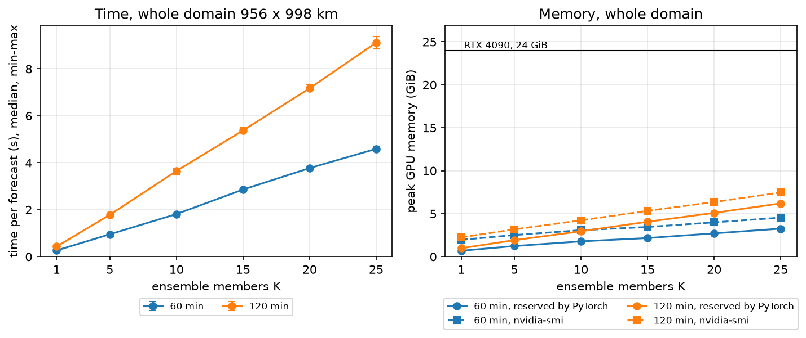

# Usage

How to run the command-line tools, what they write, and how much they cost.
These are the entry points for batch jobs on HPC. Installation is in the
[README](../README.md); why the tools work the way they do is in
[method.md](method.md).

Every script prints its full options with `--help`.

The examples are written for bash (Linux, macOS, Git Bash). In Windows
PowerShell, end continued lines with a backtick `` ` `` instead of `\`, or
write the command on one line.

## Download

```bash
# whole files from the public ORD bucket
uv run python scripts/fetch_ord_archive.py --product DBZH_QIND \
  --start 2024-07-01 --end 2024-07-06 --out data/odyssey
uv run python scripts/fetch_ord_archive.py --product DBZH \
  --start 2024-07-01 --end 2024-07-06 --out data/cirrus

# only Belgium + 350 km: reads the GeoTIFFs in pieces, or downloads and crops
# the whole HDF5 where there is no GeoTIFF (about 3 h for 12 years of ODYSSEY)
uv run python scripts/fetch_cog_crop.py --product DBZH_QIND \
  --ref "data/odyssey/OPERA@20240702T1200@0@DBZH_QIND.h5" \
  --bbox 2.5 49.45 6.45 51.55 --buffer-km 350 \
  --start 2012-09-01 --end 2024-07-06 --out data/odyssey_bel --threads 32

# pan-European bridge data from the Copernicus Climate Data Store, one file per
# month over Belgium + 350 km (token COPERNICUS_CDS_API_KEY in .env; accept the
# dataset licence on the CDS website first); a rerun skips the months on disk,
# except ERA5-Land months with preliminary hours, and waits for a request
# already queued instead of sending it again
uv run python scripts/fetch_cds.py --dataset era5-land --start 2012-01 --end 2026-10 --out data/era5land_bel
uv run python scripts/fetch_cds.py --dataset cerra-land --start 2012-01 --end 2025-12 --out data/cerraland_bel

# ERA5-Land as one Zarr store of hourly amounts in mm, written anew each time
uv run python scripts/bridge_to_zarr.py --dataset era5-land --src data/era5land_bel --out data/era5land_bel.zarr

# Belgium mask on the full CIRRUS 1 km grid (Natural Earth 1:10m)
uv run python scripts/make_region_mask.py --ref "data/cirrus/OPERA@20240702T1205@0@DBZH.h5" \
  --country BEL --out data/mask_BEL_1km.npy
```

`fetch_ord_archive.py --dry-run` prints the number of files and the size
without downloading. Cropped files keep the crop offset in `where`, so they are
read like whole files.

## Validation against CIRRUS

```bash
uv run python scripts/opera_ds_cli.py validate \
  --odyssey-glob "data/odyssey/*@DBZH_QIND.h5" --cirrus-glob "data/cirrus/*@DBZH.h5" \
  --time-regex "@(\d{8}T\d{4})@" --time-format "%Y%m%dT%H%M" \
  --start 2024-07-01 --end 2024-07-06 \
  --bbox 2.5 49.45 6.45 51.55 --buffer-km 200 --region-mask data/mask_BEL_1km.npy \
  --shifts 0 -2.5 -5 2.5 --methods nearest linear lk lk:dB \
  --pair-stride 1 --workers 12 --out results/val_2024-07_BEL
```

Run time for these 4 days on each machine: see *Measured costs*. Output folder:

| file | content |
|---|---|
| `summary.csv` | scores by method, shift and `alpha`: dBZ scores, categorical scores, FSS, small-scale energy, `r*` columns in R by scale (1, 2, 5, 10, 25 km) |
| `mass_internal.csv` | conservation against ODYSSEY itself: output volume against (1−a)·V(F0) + a·V(F1), 2 × 2 block means at `a = 0` |
| `accum_1h.csv` | hourly accumulations against CIRRUS on the available times, by scale (needs `--pair-stride 1`) |
| `per_time.csv` | scores for each time |
| `qq.json` | quantiles for the QQ plot |
| `grid_check.txt` | alignment of the two grids from the `where` metadata |
| `*.png` | `validation_overview.png`, `qq.png`, `time_shift.png` (which shift minimises the error) |

## Production of 1 km / 5 min frames

```bash
uv run python scripts/opera_ds_cli.py downscale \
  --odyssey-glob "data/odyssey/*@DBZH_QIND.h5" \
  --time-regex "@(\d{8}T\d{4})@" --time-format "%Y%m%dT%H%M" \
  --start 2024-07-01 --end 2024-07-02 \
  --bbox 2.5 49.45 6.45 51.55 --buffer-km 200 --workers 8 --out results/ds
```

Output: ODIM HDF5 2.4, DBZH uint16 (gain 0.01, offset −50), gzip. `alpha`,
`interpolated`, `time_shift_min`, `source_t0` and `method` are in
`dataset1/how`. `--time-shift -2.5` gives CIRRUS-convention labels (see
[method.md](method.md), *Output labels*).

## Training windows

```bash
# 1. choose windows on ODYSSEY at 2 km
uv run python scripts/opera_ds_cli.py sample \
  --odyssey-glob "data/odyssey/*@DBZH_QIND.h5" \
  --time-regex "@(\d{8}T\d{4})@" --time-format "%Y%m%dT%H%M" \
  --start 2024-07-01 --end 2024-07-06 --workers 10 --out results/windows.csv

# 2. interpolate them into a Zarr store in IRENE format
uv run python scripts/opera_ds_cli.py windows \
  --odyssey-glob "data/odyssey/*@DBZH_QIND.h5" \
  --time-regex "@(\d{8}T\d{4})@" --time-format "%Y%m%dT%H%M" \
  --windows-csv results/windows.csv --T 24 --H 256 --W 256 --context-km 150 \
  --workers 8 --out results/windows.zarr
```

- `sample` writes a CSV with `t_start`, `row0`, `col0` (1 km grid), `q`,
  `rain_score`, `nan_frac`, and next to it a JSON with parameters and
  statistics. `--max-nan-frac`, `--q-min`, `--m` and the steps control the
  selection.
- The store has `RR` (n, T, H, W) in mm/h float16, `alpha` and `time` (n, T),
  `row0` and `col0` (n,) on the OPERA 1 km grid; its attributes describe grid,
  Z–R and configuration.

## IRENE test training on the workstation (T0)

IRENE has its own environment (Python 3.13, torch with CUDA), next to DECADE;
why each step is needed is in [method.md](method.md), *IRENE on the workstation
(T0)*. On Windows, from the folder that holds `DECADE`:

```bash
git clone https://github.com/DSIP-FBK/IT4LIA-FBK-Seminar.git
cd IT4LIA-FBK-Seminar/module2-irene-nowcasting
uv venv --python 3.13 .venv
uv run --no-project python -c "import tomllib; d = tomllib.load(open('pyproject.toml', 'rb')); print('\n'.join(x for x in d['project']['dependencies'] if not x.startswith('pysteps')))" > ../deps_no_pysteps.txt
uv pip install --python .venv/Scripts/python.exe --torch-backend cu128 -r ../deps_no_pysteps.txt
uv pip install --python .venv/Scripts/python.exe --no-deps -e .
```

On Linux and on Leonardo the Python of that environment is `.venv/bin/python`
instead of `.venv/Scripts/python.exe`, here and below.

Then, from `DECADE`, with that Python:

```bash
../IT4LIA-FBK-Seminar/module2-irene-nowcasting/.venv/Scripts/python.exe scripts/irene_t0.py \
  --out results/irene_t0 --batch-size 16 --steps 300
```

It writes 400 fake windows (about 600 MB) to `--out` once (a later run with a
different `--windows` stops with an error: use a new `--out`), trains with IRENE's
`train.py`, and prints a line `T0 STATS` with time per step and GPU memory
(also in `stats_bs<batch>_k<members>_<loss>_<precision>_acc<accumulate>.json`);
TensorBoard logs and checkpoints go to `--out/logs`. `--precision bf16-mixed`,
`--ensemble-size` and `--num-workers` change the run.

## IRENE training cost on the workstation (T9)

The same script measures the training cost of other settings ([method.md](method.md),
*Training cost on the 4090 (T9)*). One case per run, alone on the GPU (check
`nvidia-smi` first), for example the paper's loss with 10 members:

```bash
../IT4LIA-FBK-Seminar/module2-irene-nowcasting/.venv/Scripts/python.exe scripts/irene_t0.py \
  --out results/irene_t9 --ensemble-size 10 --loss-class afcrps --batch-size 4 --accumulate 4 \
  --steps 110 --no-checkpoints
```

- `--loss-class` is a key of IRENE's `PIXEL_LOSSES` (`crps`, `afcrps`, `mse`,
  `mae`); `--accumulate` sets Lightning's `accumulate_grad_batches`, and
  `--steps` counts optimiser steps; `--no-checkpoints` writes no model files.
- A run needs more steps than one epoch (360 training windows / batch), or
  IRENE's early stopping finds no `val_loss` and stops with an error.
- A case that runs out of GPU memory writes `"oom": true`; one whose peak goes
  beyond the memory of the GPU writes `"exceeds_gpu_memory": true` (on Windows
  the run then goes on, much slower).
- `--table results/irene_t9` prints all the `stats_*.json` of the folder as a
  table, with seconds per optimiser step and hours per 10⁵ steps.

## IRENE inference cost on the whole domain (T8)

`scripts/irene_inference_cost.py` measures GPU memory and time of one IRENE
forecast of the whole Belgian CIRRUS crop with the pre-trained weights
`it4lia/irene` (what is measured and why: [method.md](method.md), *Inference
on the whole domain (T8)*). Two steps, from `DECADE`. First the input, with
DECADE's environment: six consecutive CIRRUS frames ending at `--end` (UTC),
as rain rate in mm/h:

```bash
uv run python scripts/irene_inference_cost.py --make-input --end 2024-07-05T22:45 --out results/irene_inference
```

It writes `cirrus_6frames.npy` (6 × 956 × 998, float32, about 23 MB) and
`cirrus_6frames.json` (files and times). Then the measurement, with the Python
of the IRENE environment (previous section), with no other job on the GPU:

```bash
../IT4LIA-FBK-Seminar/module2-irene-nowcasting/.venv/Scripts/python.exe scripts/irene_inference_cost.py \
  --input results/irene_inference/cirrus_6frames.npy --out results/irene_inference
```

The first run downloads the weights (`model.ckpt`, about 770 MB) into the
HuggingFace cache; the revision used is recorded. It prints one line per case
and writes `stats.json` and `irene_inference_cost.png` to `--out`. It stops if
another Python job is on the GPU (`--force` to ignore). `--ensemble`, `--steps`
(of 5 min), `--reps` and `--revision` change the run; `--random-weights` builds
the model without the download, to check the script only.

## Options shared by the sub-commands

- `--time-regex` must capture the timestamp in the file name; without it the
  time is read from the ODIM attributes, more slowly.
- `--bbox` and `--buffer-km` crop on read a window aligned to 2 km, identical
  for the two grids. A `--region-mask` on the full grid is cropped the same way.
- `--config configs/config_example.json` changes the parameters of
  `DownscaleConfig` and of LK.
- `--workers` sets the number of processes.

## Running on Leonardo Booster

Leonardo Booster (EuroHPC, CINECA) runs jobs with Slurm. Facts from the
[CINECA documentation](https://docs.hpc.cineca.it/hpc/hpc_data_storage.html)
(checked 3/11/2026):

- **Compute nodes have no internet access.** Every input must be on the
  cluster storage before a job starts: ORD files, the Natural Earth shapes used
  by `make_region_mask.py`, Python packages.
- **Login nodes are not for running programs.** They stop a process after
  10 min of CPU time and are shared by all users: use them only to install the
  environment, submit jobs and start transfers on the data movers. Everything
  else, even short, runs in a Slurm job.
- **Data movers** (`data.leonardo.cineca.it`) have no CPU time limit but no
  interactive shell and no Python: only `scp`, `rsync`, `sftp`, `wget`, `curl`,
  `rclone` and `aws s3`. `$WORK` and the other storage variables are not
  defined there, so paths must be absolute. From a login node they are reached
  without a new certificate, but not from inside a batch job.
- **Storage:** `$WORK` 1 TB per project by default (can be extended), `$FAST`
  1 TB per project, `$SCRATCH` deleted after 40 days without access.
- **A job lasts at most 24 hours** in `boost_usr_prod` (up to 64 nodes). The
  QoS `boost_qos_lprod` allows 4 days, with at most 8 nodes per project;
  `boost_qos_dbg` allows 30 minutes for tests
  ([CINECA documentation](https://docs.hpc.cineca.it/hpc/leonardo.html),
  checked 3/11/2026).

### 1. Environment (login node, the only step that runs there)

Leonardo provides compilers, libraries and Python packages as environment
modules (`module av`, `module load`). PyTorch and other machine-learning
packages are in `cineca-ai`: `module load profile/deeplrn`, then
`module av cineca-ai` lists the versions
([CINECA documentation](https://docs.hpc.cineca.it/hpc/hpc_cineca-ai-hpyc.html)).
How the project environment is built on top of the modules is still open
([roadmap.md](roadmap.md), *Setup on Leonardo Booster*); until then:

```bash
uv sync
```

In job scripts set `UV_OFFLINE=1` and `UV_FROZEN=1`, so that `uv run` never
tries to reach the network.

### 2. Data (data mover)

The Python download scripts cannot run on the data movers. Two ways:

```bash
# whole files of one year straight from the public bucket (no credentials);
# typed on a login node, runs on the data mover ($WORK is expanded before ssh)
ssh -xt data.leonardo.cineca.it rclone copy \
  ":s3,provider=Other,endpoint='https://s3.waw3-1.cloudferro.com':openradar-archive/2013/" \
  "$WORK/opera/odyssey/2013" --include "*/*/OPERA/COMP/OPERA@*@0@DBZH_QIND.h5" \
  --transfers 16

# files that already exist on another machine (e.g. the Belgian crops),
# from that machine
rsync -PravzHS data/odyssey_bel/ <username>@data.leonardo.cineca.it:<absolute path>/odyssey_bel/
```

`rclone` keeps the bucket layout (`MM/DD/OPERA/COMP/` under the year), so the
globs become recursive, e.g. `--odyssey-glob "<path>/**/*@DBZH_QIND.h5"`. The region
mask downloads Natural Earth: make it on another machine and copy it, or fetch
the shapes on the data mover and run `make_region_mask.py` in a job, which then
finds them in `--cache-dir`:

```bash
ssh -xt data.leonardo.cineca.it wget -P "$WORK/opera/naturalearth" \
  https://naciscdn.org/naturalearth/10m/cultural/ne_10m_admin_0_countries.zip
```

### 3. Jobs (compute nodes)

Run the sub-commands of `opera_ds_cli.py` inside Slurm jobs, with `--workers`
equal to the CPUs of the task (`$SLURM_CPUS_PER_TASK`) and every path on the
cluster storage.

Anything longer than the 24-hour limit runs as a chain of jobs, each started
when the previous one ends (`sbatch --dependency=afterany:<job id>`), and must
resume from partial results: production skips the chunks already written,
training restarts from its last checkpoint. The current CLI does not resume yet
([roadmap.md](roadmap.md), D1 and T1).

## Measured costs

Two machines: a Linux machine with 16 cores and local disk, and the Windows
workstation (Windows 11, Intel i9-13900KF, 32 threads, 64 GB RAM, local disk;
measured in November 2026 for S0). "—" means not measured on that machine.

| step | 16 cores | workstation |
|---|---|---|
| `validate`, Belgium + 200 km, 4 days, 4 methods, 4 shifts | about 21 min with 12 processes | 4.4 min with 12 processes |
| `sample`, whole domain | 5 days in 43 s with 10 processes, so about 10 h for 12 years of ODYSSEY | — |
| `windows` | about 8 s of CPU and 1.1–1.6 MB per 24 × 256 × 256 window | — |
| `fetch_ord_archive.py`, whole files of both products, 1–6/7/2024 | — | 3.1 GB in 5 min |
| `fetch_cog_crop.py`, Belgium + 350 km, ODYSSEY | about 3 h for 12 years with 32 threads | 15 min and 3.0 GB for one year (2023) with 32 threads |
| `fetch_cog_crop.py`, Belgium + 350 km, CIRRUS | — | 1.2 h and 25.5 GB (258 kB per frame) for one year (2025) with 32 threads |
| `fetch_cds.py`, ERA5-Land, Belgium + 350 km | 6.6 h and 2.9 GB for 178 months with 4 requests at a time (queue on the CDS, not local work) | — |
| `bridge_to_zarr.py`, ERA5-Land, 178 months | 4.5 min, 3.0 GB | — |
| synthetic test (`uv run pytest`) | about 2.5 min locally, 3 min on GitHub Actions | 3.9 min |

With the IRENE parameters `sample` selects about 56,000 windows in 5 days, so
about 50 million over 12 years.

### One IRENE forecast of the whole domain (T8)

`scripts/irene_inference_cost.py` on the workstation, 12/11/2026: RTX 4090
(24 GiB, driver 610.60), torch 2.11.0+cu128, fp32, weights `it4lia/irene` at
revision `6a37e54`, IRENE code `676ffe7`, no other job on the GPU (checked
with `nvidia-smi` before the run). Input: 6 CIRRUS frames of 956 × 998 km
(5/7/2024 22:20–22:45), padded to 960 × 1024.
Time: median of 5 forecasts after a warm-up, from rain rate in to rain rate
out. Memory: peak allocated and reserved by PyTorch, and peak in use by
`nvidia-smi` (CUDA context and the desktop included, 0.9 GiB before the
run). What the numbers mean: [method.md](method.md), *Inference on the whole
domain (T8)*.

| members K | time, 60 min | time, 120 min | allocated, 60 / 120 min | reserved, 60 / 120 min | `nvidia-smi`, 60 / 120 min |
|---:|---:|---:|---:|---:|---:|
| 1 | 0.27 s | 0.43 s | 0.63 / 0.72 GiB | 0.69 / 0.98 GiB | 1.96 / 2.24 GiB |
| 5 | 0.95 s | 1.78 s | 0.86 / 1.34 GiB | 1.23 / 1.92 GiB | 2.52 / 3.18 GiB |
| 10 | 1.81 s | 3.65 s | 1.29 / 2.22 GiB | 1.78 / 2.96 GiB | 3.08 / 4.23 GiB |
| 15 | 2.86 s | 5.38 s | 1.74 / 3.10 GiB | 2.17 / 4.06 GiB | 3.45 / 5.33 GiB |
| 20 | 3.77 s | 7.17 s | 2.17 / 3.97 GiB | 2.71 / 5.09 GiB | 3.99 / 6.36 GiB |
| 25 | 4.59 s | 9.12 s | 2.61 / 4.85 GiB | 3.26 / 6.20 GiB | 4.54 / 7.47 GiB |
| 10, one 256 × 256 patch | 0.25 s | 0.53 s | 0.42 / 0.46 GiB | 0.56 / 0.56 GiB | 1.83 / 1.83 GiB |

No case ran out of memory.



### IRENE training on the 4090 (T9)

`scripts/irene_t0.py` on the workstation, 12/11/2026: RTX 4090 (24 GiB,
driver 610.60), torch 2.11.0+cu128, IRENE code `676ffe7`, 400 fake windows of
24 × 256 × 256, 4 `spawn` workers, no checkpoints, one case at a time with no
other job on the GPU (checked with `nvidia-smi`). Time: median per batch from
the 11th step, with the batch already loaded (GPU work only); per optimiser
step it is that times the accumulated batches. Memory: peak allocated by
PyTorch in training and in validation (10 members; validation batch 20 when
the batch is 32). "Beyond" means a peak above the memory of the card, where
the run goes on, slower. What the numbers mean: [method.md](method.md),
*Training cost on the 4090 (T9)*.

| members | loss | precision | batch × accumulated | s per batch | s per optimiser step | h per 10⁵ steps | GiB, training | GiB, validation |
|---:|---|---|---|---:|---:|---:|---:|---:|
| 2 | CRPS | fp32 | 8 | 0.22 | 0.22 | 6.0 | 4.2 | 5.9 |
| 2 | CRPS | fp32 | 16 | 0.32 | 0.32 | 8.8 | 7.4 | 11.2 |
| 2 | CRPS | fp32 | 32 | 0.56 | 0.56 | 15.4 | 13.8 | 13.8 |
| 2 | CRPS | bf16 | 8 | 0.21 | 0.21 | 5.9 | 5.8 | 5.9 |
| 2 | CRPS | bf16 | 16 | 0.27 | 0.27 | 7.6 | 7.8 | 11.2 |
| 2 | CRPS | bf16 | 32 | 0.42 | 0.42 | 11.7 | 11.9 | 13.8 |
| 10 | CRPS | fp32 | 4 | 0.80 | 0.80 | 22.2 | 11.3 | 3.3 |
| 10 | CRPS | fp32 | 6 | 0.93 | 0.93 | 25.8 | 16.7 | 4.6 |
| 10 | CRPS | fp32 | 8 | 1.63 | 1.63 | 45.2 | 21.9, beyond | 5.9 |
| 10 | CRPS | fp32 | 16 | more than 90 | | | beyond | |
| 10 | CRPS | bf16 | 4 | 1.03 | 1.03 | 28.7 | 22.4 | 3.3 |
| 10 | CRPS | bf16 | 8 | about 27 | | | beyond | |
| 10 | afCRPS | fp32 | 4 | 0.82 | 0.82 | 22.9 | 12.8 | 5.7 |
| 10 | afCRPS | fp32 | 4 × 4 = 16 | 0.87 | 3.47 | 96.3 | 12.8 | 5.7 |
| 10 | afCRPS | fp32 | 4 × 8 = 32 | 0.82 | 6.60 | 183.3 | 12.8 | 5.7 |
| 10 | afCRPS | fp32 | 6 | 0.97 | 0.97 | 26.8 | 18.8 | 8.1 |
| 10 | afCRPS | fp32 | 8 | 2.13 | 2.13 | 59.2 | 24.7, beyond | 10.6 |
| 10 | afCRPS | bf16 | 4 | 1.24 | 1.24 | 34.5 | 23.9, beyond | 5.7 |

- Not run: 10 members at batch 32 (CRPS and afCRPS) and afCRPS at batch 16,
  which need more memory than the batch-16 CRPS case that already ran at more
  than 90 s per step; afCRPS in bf16 at batch 8, beyond the card like CRPS.
- Stopped and read from the TensorBoard log: CRPS bf16 at batch 8 after 69 of
  110 steps (27.4 s per step from step 9 to 69); CRPS fp32 at batch 16 after
  15 minutes with fewer than 10 steps.
- The 4 × 4 case ran while a CPU job (VMM hourly sums, 12 processes) was
  running: 0.87 s per batch against 0.82 s alone. The phase-1 plan in
  [roadmap.md](roadmap.md) uses 0.825 s.

Each window currently rereads and decompresses its 9–11 whole ODYSSEY files:
see [roadmap.md](roadmap.md) for the planned grouping by time.
